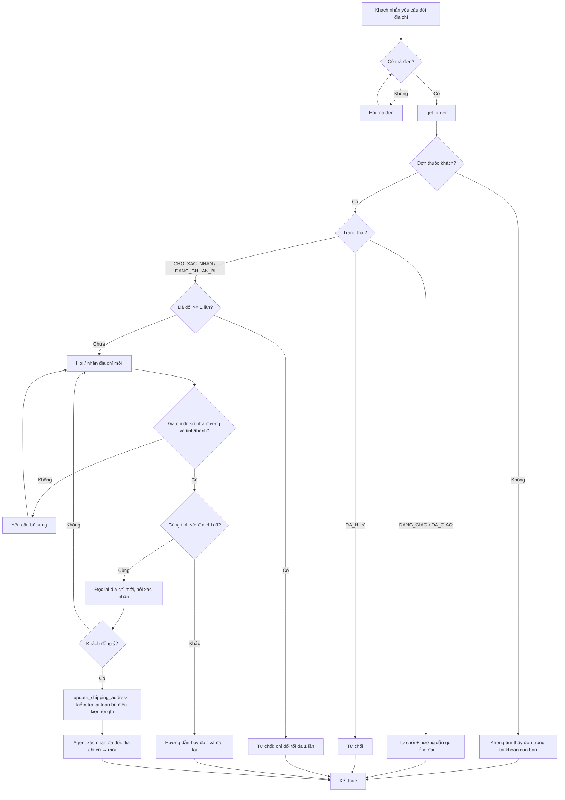

# Bài 7 – Agent tự phục vụ đổi địa chỉ giao hàng

## A. Báo cáo phân tích và thiết kế giải pháp

### 1. Phân tích bài toán (I/O)

**Dữ liệu đầu vào**

| Trường | Kiểu | Nguồn | Ghi chú |
|---|---|---|---|
| `customerId` | `string` | Phiên đăng nhập | **Không** lấy từ lời khách hay từ model, để không giả mạo được chủ đơn. |
| `orderId` | `string` | Khách nhập | Mã đơn, ví dụ `"1001"` |
| `street` | `string` | Khách nhập, model tách ra | Số nhà, đường, phường/xã. Được gộp khoảng trắng, tối thiểu 5 ký tự và phải có chữ/số. |
| `province` | `string` | Khách nhập, model tách ra | Tỉnh/thành. Được chuẩn hóa về 1 trong 34 tên chuẩn (`"HCM"`, `"Sài Gòn"` → `TP Hồ Chí Minh`). |
| Xác nhận của khách | text | Khách nhập | Khách phải đồng ý trước khi agent ghi dữ liệu |

**Dữ liệu đơn hàng đọc từ hệ thống:** `status` (`CHO_XAC_NHAN` \| `DANG_CHUAN_BI` \| `DANG_GIAO` \| `DA_GIAO` \| `DA_HUY`), `address {street, province}`, `addressChangeCount: number`, `customerId`.

**Kết quả đầu ra mong đợi**

| Nhánh | Kết quả |
|---|---|
| Thành công | Địa chỉ đơn được cập nhật, `addressChangeCount + 1`. Khách nhận lời xác nhận kèm địa chỉ cũ → mới. |
| Đơn không thuộc khách / không tồn tại | Không đọc, không ghi. *"Không tìm thấy đơn X trong tài khoản của bạn…"* (không để lộ đơn có tồn tại hay không) |
| `DANG_GIAO` / `DA_GIAO` | Từ chối, hướng dẫn gọi tổng đài `1900 1234` |
| Trạng thái khác (`DA_HUY`) | Từ chối |
| Đã đổi 1 lần | Từ chối: mỗi đơn chỉ đổi tối đa 1 lần |
| Khác tỉnh/thành | Từ chối: khách cần hủy đơn và đặt lại |
| Địa chỉ trống / chỉ có khoảng trắng / thiếu tỉnh / tỉnh không nhận ra | Không ghi, yêu cầu khách bổ sung |

### 2. Đề xuất giải pháp

Agent dùng **2 tool**, vừa đủ cho quy trình 1 đọc + 1 ghi:

| Tool | Loại | Trách nhiệm |
|---|---|---|
| `get_order(orderId)` | Chỉ đọc | Kiểm tra quyền sở hữu, trả trạng thái, địa chỉ hiện tại, số lần đã đổi, `canChangeAddress` và `blockedReason`, để agent dừng sớm và giải thích được lý do. |
| `update_shipping_address(orderId, street, province)` | Ghi | Kiểm tra lại **toàn bộ** điều kiện nghiệp vụ ngay trước khi ghi (sở hữu, trạng thái, số lần đổi, địa chỉ hợp lệ, cùng tỉnh), rồi mới cập nhật. |

Không cần tool riêng cho việc kiểm tra địa chỉ, vì phần đó đã nằm trong tool ghi. Cũng không cần tool hủy đơn, vì quy định là khách tự hủy và đặt lại.

Nguyên tắc chính:

- `customerId` được truyền từ phiên đăng nhập vào executor, không phải tham số tool.
- Model chỉ điều hướng hội thoại. **Mọi quy tắc nghiệp vụ đều được kiểm tra bằng code** (`src/services.ts`), kể cả khi model gọi tool sai thứ tự.
- Tool bật `strict: true` để tham số luôn đúng lược đồ. Lỗi nghiệp vụ được trả về dạng `tool_result` có `is_error: true` với câu chữ thân thiện, để agent diễn đạt lại cho khách.

### 3. Các bước xử lý



## B. Triển khai và chống lỗi

| File | Nội dung |
|---|---|
| `src/data.ts` | Dữ liệu đơn giả lập, danh sách 34 tỉnh/thành, tên gọi khác |
| `src/address.ts` | Chuẩn hóa khoảng trắng, bỏ dấu, nhận diện tỉnh/thành |
| `src/services.ts` | Nghiệp vụ và các điều kiện chặn (khớp từng nhánh của lưu đồ) |
| `src/tools.ts` | Định nghĩa 2 tool và executor (gắn `customerId` từ phiên) |
| `src/agent.ts` | Vòng lặp agent theo phiên chat |
| `src/main.ts` | Chat CLI |

Đoạn mã chặn các bẫy dữ liệu (trong `src/services.ts`):

| Bẫy | Cách chặn | Thông báo cho khách |
|---|---|---|
| Địa chỉ chỉ có khoảng trắng | `cleanText` rồi kiểm tra độ dài ≥ 5 và có chữ/số | *"Địa chỉ mới đang trống hoặc quá ngắn. Bạn vui lòng cho biết số nhà, tên đường và phường/xã nhé."* |
| Thiếu tỉnh/thành | `province` rỗng sau khi trim | *"Địa chỉ mới còn thiếu tỉnh/thành phố. Bạn bổ sung giúp ShopFast nhé."* |
| Tỉnh không tồn tại | `findProvince` trả `null` | *"ShopFast chưa nhận ra tỉnh/thành "…". Bạn kiểm tra lại tên tỉnh/thành phố giúp nhé."* |
| Đổi địa chỉ đơn của người khác | `getOwnedOrder` so `order.customerId` với `customerId` của phiên, dùng cho **cả** tool đọc và tool ghi | *"Không tìm thấy đơn X trong tài khoản của bạn. Bạn kiểm tra lại mã đơn giúp ShopFast nhé."* |

Chạy:

```bash
npm install
npm test               # test các nhánh nghiệp vụ và bẫy dữ liệu, không cần API key
npm start -- KH01      # chat với agent trong vai khách KH01 (cần ANTHROPIC_API_KEY)
```

Dữ liệu mẫu cho khách `KH01`: `1001` (chờ xác nhận, Hà Nội), `1002` (đang chuẩn bị, TP HCM), `1003` (đang giao), `1004` (đã giao), `1005` (đã đổi 1 lần). Đơn `2001` thuộc `KH02`.
