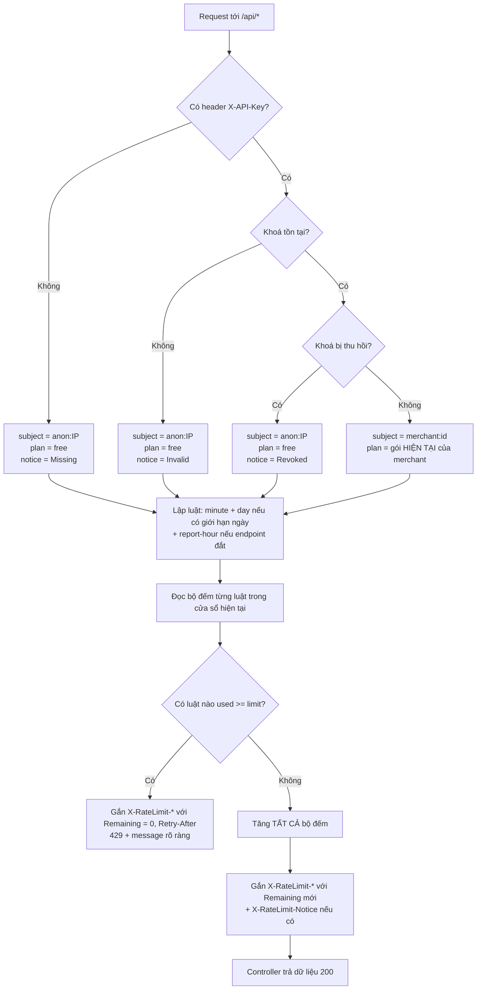

# Bài tập 7 – Hệ thống hạn mức phân tầng theo gói dịch vụ

## A. Báo cáo phân tích và thiết kế giải pháp

### A1. Phân tích bài toán (I/O)

**Dữ liệu vào cần có để quyết định cho qua hay chặn**

| Trường | Kiểu | Nguồn | Vai trò |
|---|---|---|---|
| `apiKey` | `string \| undefined` | header `X-API-Key` | Định danh nhà bán hàng; có thể thiếu, sai hoặc đã bị thu hồi |
| `merchantId` | `string` | tra từ `apiKey` | Chủ thể bị đếm (mọi khoá của một nhà bán hàng dùng chung hạn mức) |
| `plan` | `'free' \| 'pro' \| 'enterprise'` | tra từ `merchantId` **tại thời điểm request** | Chọn bộ hạn mức |
| `revoked` | `boolean` | bản ghi khoá | Khoá đã thu hồi thì không được hưởng gói |
| `ip` | `string` | kết nối | Chủ thể đếm khi không có khoá hợp lệ |
| `expensive` | `boolean` | metadata của route (`@ExpensiveEndpoint()`) | Bật thêm tầng 10 request/giờ |
| `now` | `number` (ms) | đồng hồ máy chủ | Xác định cửa sổ phút/giờ/ngày |
| `count[subject, rule, window]` | `number` | kho bộ đếm | Số request đã dùng trong cửa sổ hiện tại |

**Phản hồi ở cả hai nhánh**

| Nhánh | Status | Tiêu đề | Body |
|---|---|---|---|
| Cho qua | `200` | `X-RateLimit-Plan`, `X-RateLimit-Limit/Remaining/Reset-Minute`, `-Day` (Enterprise: `unlimited`), `-Report-Hour` (endpoint báo cáo); thêm `X-RateLimit-Notice` nếu thiếu/sai/thu hồi khoá | Dữ liệu nghiệp vụ |
| Chặn | `429` | Như trên (Remaining = 0) + `Retry-After` (giây) | `{ statusCode, error, message, plan, limit, retryAfterSeconds }`, trong đó `message` nói rõ đã hết hạn mức nào, của gói nào, chờ bao lâu, lý do bị hạ gói nếu có |

### A2. Ý tưởng giải pháp

- **Lưu bộ đếm ở đâu**: `CounterStore`, một kho key-value có thời hạn. Bản nộp dùng in-memory. Khi chạy nhiều instance thì thay bằng Redis (`INCR` + `PEXPIRE` trong script Lua) với cùng giao diện.
- **Khoá định danh bộ đếm**: `<chủ thể>:<tên hạn mức>:<số thứ tự cửa sổ>`
  - chủ thể = `merchant:<id>` khi khoá hợp lệ, `anon:<ip>` khi không có khoá, khoá sai hoặc đã thu hồi;
  - tên hạn mức = `minute | day | report-hour`;
  - số thứ tự cửa sổ = `floor(now / độ dài cửa sổ)` (ngày tính theo giờ VN, reset lúc 00:00).
  - **Không** đưa tên gói vào khoá. Vì vậy khi nâng gói, bộ đếm vẫn giữ nguyên, chỉ ngưỡng đổi, nên hạn mức mới có hiệu lực ngay ở request kế tiếp.
- **Nhiều tầng cùng lúc**: với mỗi request, lập danh sách luật áp dụng (phút + ngày nếu gói có giới hạn ngày + giờ nếu là endpoint báo cáo). Bước 1 **chỉ đọc** mọi bộ đếm. Nếu có tầng nào đã đủ thì chặn, báo tầng có thời điểm reset muộn nhất. Chỉ khi mọi tầng còn suất mới tăng **tất cả** bộ đếm. Nhờ vậy request bị chặn không làm hao hạn mức ngày.
- **Tách lớp**: `plans.ts` (chính sách) → `QuotaService` (thuật toán nhiều tầng) → `QuotaGuard` (định danh, tiêu đề, thông báo) → `CounterStore` (lưu trữ).

### A3. Các bước xử lý

Tóm tắt các bước:
1. Đọc `X-API-Key`. Không có, không tồn tại hoặc đã thu hồi thì đếm theo IP ở gói thấp nhất (Free) và gắn thông báo.
2. Khoá hợp lệ thì lấy gói **hiện tại** của nhà bán hàng (không cache theo chu kỳ).
3. Lập danh sách tầng hạn mức theo gói và theo loại endpoint.
4. Đọc mọi bộ đếm. Nếu có tầng đã đủ thì trả `429`, rẽ nhánh kết thúc.
5. Còn suất ở mọi tầng thì tăng mọi bộ đếm, gắn tiêu đề, cho request vào controller.

## B. Triển khai và chống lỗi

| Bẫy dữ liệu | Đoạn mã chặn | Thông báo cho nhà bán hàng |
|---|---|---|
| Nâng gói giữa chừng | `MerchantStore.resolveKey` luôn đọc `merchant.plan` hiện tại; khoá bộ đếm trong `QuotaService.window` không chứa tên gói | `X-RateLimit-Plan: pro`, `X-RateLimit-Remaining-Minute` tính theo ngưỡng mới ngay request kế tiếp |
| Không mang khoá | `QuotaGuard.canActivate`: nhánh `resolution.status !== 'valid'` thì `subject = anon:<ip>`, `plan = LOWEST_PLAN` | Header `X-RateLimit-Notice: Missing X-API-Key ...`; khi bị chặn, `message` nói rõ "Thiếu khoá API ..." |
| Khoá đã thu hồi | `MerchantStore.resolveKey` trả `revoked`, cùng nhánh trên | `Revoked X-API-Key ...`; `message`: "Khoá API đã bị thu hồi ... Vui lòng tạo khoá mới." |

Kiểm thử: `npm test` (12 ca), gồm cả 3 bẫy trên, hạn mức ngày 5.000, Enterprise không giới hạn ngày và endpoint báo cáo 10 request/giờ cho mọi gói.

API thử nghiệm (`npm start`):
- `GET /api/products`, `GET /api/reports/inventory`, header `X-API-Key: key-free-001 | key-pro-001 | key-ent-001`
- `PATCH /admin/merchants/:id/plan` body `{ "plan": "pro" }`, `POST /admin/keys/:key/revoke` (header `X-Admin-Token: admin-secret`)
