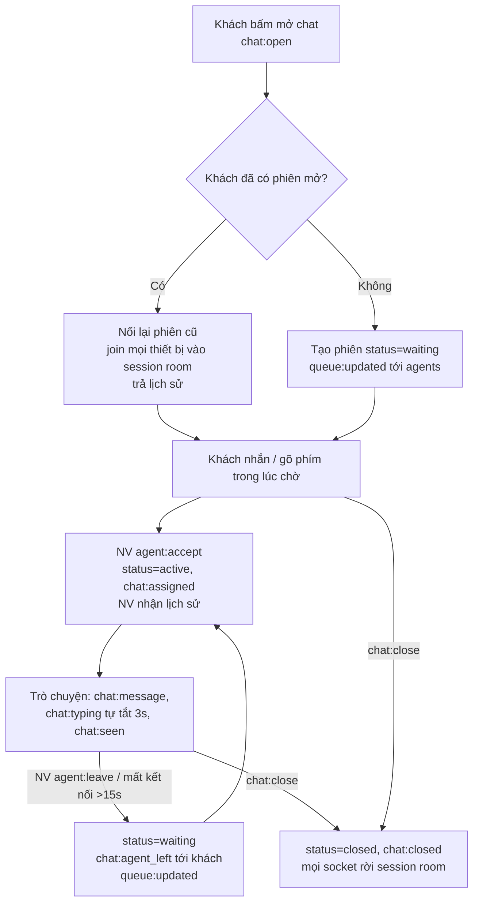

# Bài tập 7 – Khung chat hỗ trợ khách hàng thời gian thực

| File | Nội dung |
|---|---|
| `src/chat/contracts.ts` | Hợp đồng sự kiện + kiểu dữ liệu dùng chung |
| `src/chat/chat.service.ts` | Trạng thái phiên, quy tắc nghiệp vụ, chặn dữ liệu bẫy |
| `src/chat/chat.gateway.ts` | Gateway Socket.IO: xác thực, room, typing, đã xem, rời phiên |
| `src/chat-client.ts` | Logic phía client (app khách / màn hình CSKH) |
| `src/demo.ts` | Kịch bản 2 thiết bị khách + 2 nhân viên (`npm run demo`) |
| `test/chat.test.ts` | Kiểm thử (`npm test`, 8/8 pass) |

---

## A. Báo cáo phân tích và thiết kế giải pháp

### 1. Phân tích bài toán (I/O) – bảng sự kiện

Mọi kết nối phải gửi `auth: { token }` khi bắt tay; server gắn `socket.data.user = { id, name, role }`.

**Client → Server** (mọi sự kiện đều có ack `{ ok: true, data } | { ok: false, error: string }`)

| Sự kiện | Ai gửi | Dữ liệu gửi kèm | Ack trả về |
|---|---|---|---|
| `chat:open` | Khách | `{}` | `SessionView` – phiên mới hoặc phiên đang mở của chính khách |
| `chat:message` | Khách / NV | `{ sessionId: string, clientMsgId: string, text: string }` | `ChatMessage` |
| `chat:typing` | Khách / NV | `{ sessionId: string, isTyping: boolean }` | – |
| `chat:seen` | Khách / NV | `{ sessionId: string, messageId: string }` | `SeenEvent \| null` |
| `agent:accept` | NV | `{ sessionId: string }` | `SessionView` (kèm lịch sử) |
| `agent:leave` | NV | `{ sessionId: string }` | `SessionView` |
| `chat:close` | Khách / NV | `{ sessionId: string }` | `SessionView` |

**Server → Client**

| Sự kiện | Ai nhận | Dữ liệu |
|---|---|---|
| `chat:session` | Các thiết bị khác của cùng khách | `SessionView` |
| `chat:message` | Mọi socket trong phiên trừ socket gửi | `ChatMessage { id: string, sessionId: string, clientMsgId: string, from: 'customer'\|'agent', senderId: string, text: string, sentAt: number }` |
| `chat:typing` | Phía bên kia (mọi thiết bị) | `{ sessionId: string, from: Role, isTyping: boolean }` |
| `chat:seen` | Mọi người trong phiên | `{ sessionId: string, by: Role, messageId: string }` |
| `chat:assigned` | Mọi người trong phiên | `{ sessionId: string, agent: { id: string, name: string } }` |
| `chat:agent_left` | Khách | `{ sessionId: string, message: string }` |
| `chat:closed` | Mọi người trong phiên | `{ sessionId: string, by: Role }` |
| `queue:updated` | Tất cả nhân viên | `QueueItem[] = { sessionId: string, customerId: string, waitingSince: number }[]` |

`SessionView = { id, customerId, agentId: string|null, status: 'waiting'|'active'|'closed', messages: ChatMessage[], seen: { customer: string|null, agent: string|null } }`

### 2. Ý tưởng giải pháp

- **Room**
  - `user:<userId>`: mọi thiết bị của cùng một người. Đây là cách đồng bộ nhiều thiết bị và nhận biết người đó còn online hay không.
  - `session:<sessionId>`: mọi thiết bị của khách và của nhân viên phụ trách. Tin nhắn, đã xem, gán/rời đều phát vào room này. Khi khách mở phiên hoặc nhân viên nhận phiên, server dùng `server.in('user:<id>').socketsJoin('session:<id>')` để đưa **tất cả** thiết bị của người đó vào phiên.
  - `agents`: mọi nhân viên, dùng để nhận `queue:updated`.
- **Trạng thái phiên** nằm duy nhất trên server (`ChatService`): danh sách phiên, `openByCustomer` (mỗi khách tối đa 1 phiên mở → mở lại là nối lại), lịch sử tin nhắn, con trỏ “đã xem”, hàng chờ. Thiết bị chỉ là bản sao, kết nối lại là được tự join lại room.
- **Nhiều thiết bị**
  - Tin gửi từ thiết bị A được phát `socket.to(session)` → thiết bị B của cùng người cũng nhận; thiết bị A dùng ack.
  - Mỗi tin có `clientMsgId` do client sinh; server khử trùng lặp theo khoá này. Gửi lại khi mất ack hoặc bấm 2 lần thì vẫn chỉ có 1 tin. Client cũng bỏ qua tin trùng `id`.
  - “Đang soạn” và “đã xem” chỉ gửi cho phía bên kia (`.except('user:<người gửi>')`).
- **Đang soạn tin**: client gửi `isTyping: true` tối đa 1 lần/giây khi gõ. Server giữ timer 3 giây cho mỗi `(phiên, người)`, gia hạn khi có tín hiệu mới, hết hạn thì tự phát `isTyping: false`. Gửi tin, rời phiên hay mất hết thiết bị cũng tắt luôn, nên không có trạng thái “đang soạn” bị treo.
- **Đã xem**: client chỉ gửi `chat:seen` khi khung chat đang mở thật trên màn hình (`windowOpen`). Server chỉ chấp nhận tin của phía bên kia và con trỏ chỉ tiến lên, không lùi.
- **Nhân viên rời phiên**: `agent:leave` → phiên về `waiting`, nhân viên bị gỡ khỏi room phiên, khách nhận `chat:agent_left`, mọi nhân viên nhận hàng chờ mới. Nếu nhân viên mất hết thiết bị quá 15 giây (thời gian ân hạn để kịp nối lại) thì server xử lý như rời phiên.
- **Phân quyền**: chỉ khách chủ phiên và nhân viên đang phụ trách mới thao tác được trên phiên.

### 3. Vòng đời một phiên chat



Tuần tự:
1. Khách mở khung chat → `chat:open` → server tìm phiên mở của khách. Có thì nối lại, không có thì tạo phiên `waiting` và báo hàng chờ cho nhân viên.
2. Mọi thiết bị của khách được đưa vào `session:<id>`; thiết bị khác nhận `chat:session`.
3. Khách có thể nhắn ngay; tin được lưu lại để nhân viên đọc khi nhận phiên.
4. Nhân viên `agent:accept` → phiên `active`, nhân viên vào room, khách nhận `chat:assigned`.
5. Hai bên nhắn tin, có “đang soạn” và “đã xem”.
6. Nhân viên rời đi → phiên về hàng chờ (quay lại bước 4 với nhân viên khác).
7. Khách hoặc nhân viên `chat:close` → phiên `closed`, giải phóng room. Khách mở lại thì có phiên mới.

---

## B. Triển khai và chống lỗi

Code khớp thiết kế ở phần A: tên sự kiện nằm ở `contracts.ts`, room nằm ở `chat.gateway.ts`, trạng thái nằm ở `chat.service.ts`.

### Chặn bẫy dữ liệu (`src/chat/chat.service.ts`)

```ts
export function validateText(text: unknown): string {
  if (typeof text !== 'string') throw new ChatError('Tin nhan khong hop le');
  const trimmed = text.trim();
  if (trimmed === '') throw new ChatError('Tin nhan khong duoc de trong');
  if (trimmed.length > MAX_MESSAGE_LENGTH) {
    throw new ChatError(
      `Tin nhan qua dai (${trimmed.length} ky tu). Vui long chia nho, toi da ${MAX_MESSAGE_LENGTH} ky tu moi tin.`,
    );
  }
  return trimmed;
}
```

- Tin rỗng hoặc chỉ có khoảng trắng → “Tin nhắn không được để trống”.
- Tin 20.000 ký tự → “Tin nhắn quá dài (20000 ký tự). Vui lòng chia nhỏ, tối đa 2000 ký tự mỗi tin.” Ngoài ra `maxHttpBufferSize: 100_000` chặn gói tin quá lớn ngay ở tầng transport.
- Hai thiết bị cùng lúc: khử trùng lặp theo `clientMsgId` (server) và theo `id` (client).

```ts
const old = session.byClientMsgId.get(payload.clientMsgId);
if (old) return { message: old, duplicate: true };   // khong luu, khong phat lai
```

- Lỗi nghiệp vụ (`ChatError`) được trả qua ack để client hiển thị nguyên văn; lỗi khác được ghi log và trả thông báo chung, server không bị sập.

### Trích kết quả `npm run demo`

```
=== Khach mo tiep tren laptop -> noi lai dung phien cu ===
[+ 0.49s] An/laptop  phien S-b9e3fe87 - trung phien dien thoai: true
=== Lan go phim, ngung 3s -> "dang soan tin" tu tat ===
[+ 1.14s] An/phone   thay "agent dang soan tin..."
[+ 4.14s] An/phone   tat "dang soan tin"
=== Bay du lieu ===
[+ 4.76s] An/laptop  THONG BAO: Tin nhan khong duoc de trong
[+ 4.76s] An/laptop  THONG BAO: Tin nhan qua dai (20000 ky tu). Vui long chia nho, toi da 2000 ky tu moi tin.
=== Gui lai cung clientMsgId -> khong nhan doi ===
[+ 5.28s] CSKH Lan   so tin nhan: 3
[+ 5.28s] An/phone   so tin nhan: 3
=== Lan roi phien ===
[+ 5.29s] An/phone   THONG BAO: Nhan vien da roi cuoc tro chuyen. Ban dang duoc chuyen toi nhan vien khac, vui long cho.
[+ 5.29s] CSKH Minh  hang cho: [S-b9e3fe87]
```

Tin nhắn đến phía bên kia trong vài mili-giây; test `tin nhan hien o ca 2 phia duoi 1 giay` kiểm tra điều kiện < 1s.

```
npm install
npm test
npm run demo
npm start      # server o cong 3000
```
