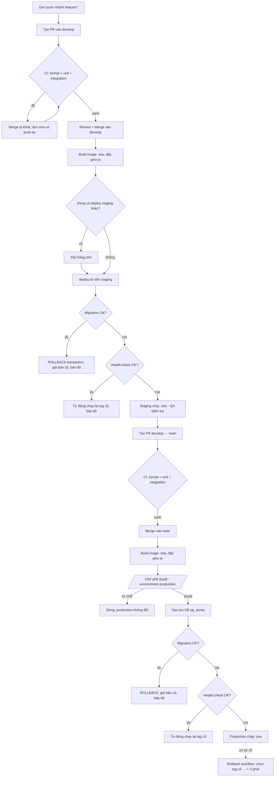

# Bài tập 7 – Pipeline nhiều môi trường cho ShopFast

## A. Báo cáo phân tích và thiết kế giải pháp

### A.1. Phân tích bài toán (I/O)

| # | Sự kiện kích hoạt (đầu vào) | Workflow | Công việc chạy | Kết quả đầu ra mong đợi |
|---|---|---|---|---|
| 1 | Tạo / cập nhật PR vào `develop` | `ci.yml` | `format`, `unit-test`, `integration-test` (song song) | 3 check xanh → nút Merge mở. Một check đỏ → Merge bị khoá |
| 2 | Tạo / cập nhật PR vào `main` (develop → main) | `ci.yml` | Giống #1 | Giống #1 |
| 3 | Push thêm commit vào PR đang chạy CI | `ci.yml` | Huỷ lần CI cũ, chạy lại trên commit mới | Chỉ kết quả của commit mới nhất được tính |
| 4 | PR được merge vào `develop` (push `develop`) | `deploy-staging.yml` | `build` → `deploy` (staging) | Image `ghcr.io/shopfast/api:<sha>` trên kho, staging chạy `<sha>`, health check xanh |
| 5 | PR được merge vào `main` (push `main`) | `deploy-production.yml` | `build` → **chờ phê duyệt** → `deploy` (production) | Image `<sha>` trên kho; sau khi người có quyền bấm *Approve*, production chạy `<sha>` |
| 6 | Hai PR merge vào cùng nhánh gần như cùng lúc | `deploy-*.yml` | Lần thứ 2 **xếp hàng** (concurrency `deploy-<env>`) | Hai lần triển khai chạy nối tiếp, không bao giờ chồng lên nhau |
| 7 | Migration lỗi giữa chừng khi deploy | `_deploy.yml` → `deploy.sh` | Transaction bị `ROLLBACK`, script dừng trước khi đổi container | Schema giữ nguyên, phiên bản cũ vẫn phục vụ, job đỏ |
| 8 | Phiên bản mới không qua health check | `deploy.sh` | Tự động `up` lại image tag cũ | Hệ thống quay về phiên bản trước, job đỏ |
| 9 | Có sự cố, cần quay lui thủ công | `rollback.yml` (workflow_dispatch) | `verify-image` → `deploy --rollback` | Môi trường chạy lại tag đã chọn trong < 3 phút |

### A.2. Đề xuất giải pháp

**Chia công việc**

- **CI (3 job song song)**: `format`, `unit-test`, `integration-test` (có service Postgres + Redis). Ba job là *required status checks* của branch protection `develop` và `main` → thất bại thì không merge được.
- **`_build.yml` (dùng chung)**: build image, gắn thẻ **mã commit** (`github.sha`), đẩy lên `ghcr.io`. Không dùng `latest` để triển khai.
- **`_deploy.yml` (dùng chung)**: SSH vào server của môi trường, ghi `.env` từ secrets, chạy `deploy.sh <tag>`.
- **`deploy-staging.yml`** = `_build` → `_deploy(staging)`.
- **`deploy-production.yml`** = `_build` → `_deploy(production)`; environment `production` bật *Required reviewers* nên job deploy dừng chờ duyệt.
- **`rollback.yml`** = `verify-image` → `_deploy(--rollback)`; không build, không test, không migration.

**Phụ thuộc giữa các job**

```
PR:            format ─┐
               unit ───┼─> (branch protection) ─> Merge
               integ ──┘
push develop:  build ─> deploy[staging]
push main:     build ─> [chờ phê duyệt] ─> deploy[production]
rollback:      verify-image ─> deploy[--rollback]
```

**Quản lý bí mật và biến môi trường**

| Nơi lưu | Nội dung | Ghi chú |
|---|---|---|
| GitHub Environment `staging` | Secrets: `SSH_HOST`, `SSH_USER`, `SSH_PRIVATE_KEY`, `DATABASE_URL`, `REDIS_URL`, `JWT_SECRET`. Variables: `APP_URL`, `LOG_LEVEL=debug` | Không có người duyệt; chỉ cho nhánh `develop` |
| GitHub Environment `production` | Cùng tên secrets, giá trị của production. Variables: `APP_URL`, `LOG_LEVEL=info` | **Required reviewers**: tech lead/trưởng nhóm; chỉ cho nhánh `main` |
| GitHub Environment `production-rollback` | Giống `production` | Không chờ duyệt để quay lui nhanh; chỉ người có quyền Maintain chạy được `workflow_dispatch` |
| `GITHUB_TOKEN` | Đăng nhập `ghcr.io` | Tự cấp mỗi lần chạy, hết hạn sau job |

Cùng một tên secret (`DATABASE_URL`…) nhưng mỗi environment có giá trị riêng → workflow dùng chung không cần `if` theo môi trường. Không có giá trị nhạy cảm nào trong repo; `.env` trên server được ghi lại mỗi lần deploy với quyền `600`.

### A.3. Thiết kế các bước – luồng từ lúc lập trình viên đẩy mã tới production



Điểm rẽ nhánh: kết quả CI, có/không đang có deploy khác, kết quả migration, kết quả health check.
Điểm chờ: hàng đợi concurrency, phê duyệt production.

---

## B. Triển khai và chống lỗi

### B.1. Source code

```
ex3/
├── .github/workflows/
│   ├── ci.yml                 # PR: format + unit + integration
│   ├── _build.yml             # dùng chung: build + push :sha
│   ├── _deploy.yml            # dùng chung: SSH + deploy.sh, concurrency theo môi trường
│   ├── deploy-staging.yml     # push develop
│   ├── deploy-production.yml  # push main, chờ phê duyệt
│   └── rollback.yml           # quay lui thủ công
├── deploy/
│   ├── docker-compose.yml     # đặt ở /opt/shopfast trên server
│   └── deploy.sh              # migrate an toàn, health check, tự quay lui
├── migrations/*.sql
├── src/ (main.ts, migrate.ts, ...)
├── test/unit, test/integration
├── Dockerfile
└── quy-trinh-quay-lui.md      # tài liệu quy trình quay lui
```

Khoá nút merge (cấu hình một lần cho `develop` và `main`):

```bash
for BRANCH in develop main; do
  gh api -X PUT repos/shopfast/api/branches/$BRANCH/protection --input - <<JSON
{
  "required_status_checks": { "strict": true, "contexts": ["format", "unit-test", "integration-test"] },
  "enforce_admins": true,
  "required_pull_request_reviews": { "required_approving_review_count": 1 },
  "restrictions": null
}
JSON
done
```

### B.2. Chặn bẫy 1 – Hai PR được merge gần như cùng lúc

| Lớp chặn | Cấu hình | Tác dụng |
|---|---|---|
| GitHub Actions | `_deploy.yml`: `concurrency: { group: deploy-${{ inputs.deploy_env }}, cancel-in-progress: false }` | Cùng môi trường chỉ một job deploy chạy; job sau ở trạng thái *Pending* tới khi job trước xong. `cancel-in-progress: false` để **không huỷ** một lần deploy đang chạy dở |
| Dùng chung group cho rollback | `rollback.yml` gọi cùng `_deploy.yml` với cùng `deploy_env` | Rollback và deploy thường không chạy chồng nhau |
| Server | `deploy.sh`: `flock -w 600` trên `/opt/shopfast/.deploy.lock` | Dù có ai chạy tay hay chạy từ nơi khác, server vẫn chỉ cho một tiến trình deploy |
| Migration | `pg_advisory_lock` trong `src/migrate.ts` | Hai tiến trình migrate không bao giờ đụng nhau trong DB |

Ghi chú: nếu có 3 lần merge dồn dập, GitHub chỉ giữ **một** job pending mới nhất (job pending cũ bị thay). Điều này đúng ý muốn, vì commit mới nhất đã chứa thay đổi của commit trước.

### B.3. Chặn bẫy 2 – Migration thất bại giữa chừng

1. **Mỗi file migration chạy trong một transaction** (`BEGIN` … `COMMIT`, lỗi → `ROLLBACK`). PostgreSQL hỗ trợ DDL trong transaction nên câu lệnh nào đã chạy trong file cũng bị huỷ – không có trạng thái nửa vời. Đã có kiểm thử tích hợp `test/integration/migrate.test.ts` chứng minh: file có câu lệnh 1 đúng, câu lệnh 2 sai → bảng của câu lệnh 1 không tồn tại sau khi chạy.
2. **Ghi nhận file đã chạy** trong `schema_migrations`; sửa lỗi rồi chạy lại thì chỉ chạy phần còn thiếu.
3. **Migration chạy trước khi đổi container** (`docker compose run --rm api node dist/migrate.js`). Thất bại → `deploy.sh` thoát, container cũ vẫn phục vụ, job đỏ.
4. **Sao lưu trước migration ở production** (`pg_dump -Fc` vào `/opt/shopfast/backups/`) – dự phòng cho câu lệnh không chạy được trong transaction (ví dụ `CREATE INDEX CONCURRENTLY`).
5. **Migration theo kiểu expand/contract**: chỉ thêm (cột có default, bảng mới) ở lần này; xoá/đổi tên ở lần triển khai sau khi không còn code cũ dùng tới. Nhờ vậy phiên bản cũ chạy được trên schema mới → rollback không cần chạy migration ngược.

Kết quả chạy thử cục bộ (Postgres 16 + Redis 7 trong Docker):

```
$ npm run format:check      -> All matched files use Prettier code style!
$ npm run test:unit         -> Tests: 3 passed, 3 total
$ npm run test:integration  -> Tests: 5 passed, 5 total
  [migrate] OK   001_ok.sql
  [migrate] FAIL 002_broken.sql -> da ROLLBACK, schema giu nguyen
```

### B.4. Quy trình quay lui

Xem `quy-trinh-quay-lui.md`.
