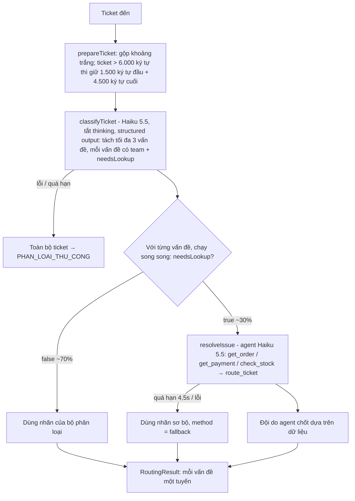

# Bài 8 – Chọn kiến trúc cho bộ định tuyến ticket 3.000 lượt/ngày

## A. Phân tích và đề xuất đa giải pháp

### Đầu vào / đầu ra

**Đầu vào:** một ticket `{ ticketId: string, text: string }`. `text` là nội dung khách gửi, có thể chỉ một câu, cũng có thể dài ~4.000 từ do khách dán cả lịch sử chat, và có thể chứa nhiều vấn đề.

**Đầu ra:** `RoutingResult`

```ts
{
  ticketId: string,
  routes: [{ summary, team, method: "classifier" | "agent" | "fallback", note? }],  // 1 vấn đề → 1 tuyến
  truncated: boolean,   // ticket đã bị lược bớt hay chưa
  latencyMs: number
}
```

`team` là 1 trong 4 đội: `DON_HANG_VAN_CHUYEN`, `THANH_TOAN`, `KHO_SAN_PHAM`, `KY_THUAT_TAI_KHOAN`. Nếu hệ thống không quyết định được thì ticket vào hàng đợi `PHAN_LOAI_THU_CONG`.

### Các giải pháp

| | Giải pháp | Mô tả |
|---|---|---|
| (a) | Một lời gọi model đơn lẻ | Mỗi ticket gọi Claude Haiku 5.5 **1 lần**, không có tool, structured output trả về đội xử lý. Không tra dữ liệu. |
| (b) | Agent đầy đủ | Mọi ticket đều vào agent Claude Sonnet 5.5 có tool `get_order`, `get_payment`, `check_stock`, `route_ticket`. Agent tự quyết định có cần tra hay không. |
| (c) | Kiến trúc lai | Haiku 5.5 phân loại và tách vấn đề cho **mọi** ticket (1 lời gọi, không tool, tắt thinking). **Chỉ** vấn đề có `needsLookup = true` (~30%) mới đi tiếp vào agent Haiku 5.5 có tool. Có deadline chung 4,5 giây, quá hạn thì dùng nhãn sơ bộ. |

## B. So sánh và lựa chọn

**Giả định tính toán:**

- 3.000 ticket/ngày × 30 = **90.000 ticket/tháng**, 1 USD ≈ 26.000đ.
- Giá theo bảng giá Anthropic (USD / 1 triệu token, vào/ra): Haiku 5.5 $0,10 / $0,50 (prompt ≤ 100K token); Sonnet 5.5 $2 / $10.
- Lời gọi phân loại: ~1.300 token vào (prompt ~700 + ticket ~600; ticket dài bị cắt về ≤ 6.000 ký tự), ~120 token ra.
- Agent: ticket đơn giản ~1.800 vào / 150 ra; ticket cần tra cứu ~3 lượt, ~4.000–5.000 vào / 300–400 ra.
- Độ chính xác là **ước lượng**: gán nhãn thuần đúng ~95%; đoán mò khi không có dữ liệu đúng ~60%; có tra dữ liệu đúng ~92–95%.

| Tiêu chí | (a) 1 lời gọi Haiku | (b) Agent Sonnet cho mọi ticket | (c) Lai: Haiku phân loại + agent Haiku cho 30% |
|---|---|---|---|
| **Chi phí ước tính/tháng** | 117M × $0,1 + 10,8M × $0,5 = **$17,1 ≈ 0,45 triệu đ** | 248M × $2 + 20M × $10 = **$699 ≈ 18,2 triệu đ** ❌ | $17,1 (phân loại) + 108M × $0,1 + 8,1M × $0,5 (agent) = **$32 ≈ 0,83 triệu đ** (dự phòng 30% → ~1,1 triệu đ) |
| **Độ trễ trung bình** | ~1 giây | Ticket đơn giản 2–3 giây; ticket cần tra 6–10 giây (nhiều lượt, có thinking) ❌ | 70% ticket ~1 giây; 30% ticket ~3–4 giây, **trần cứng 4,5 giây** |
| **Độ chính xác dự kiến** | 0,7 × 95% + 0,3 × 60% ≈ **84,5%** | ≈ **95%** | 0,7 × 95% + 0,3 × 92% ≈ **94%** |
| **Ticket gán sai / ngày (× 6 phút)** | ~465 → **46,5 giờ công/ngày** | ~150 → 15 giờ công/ngày | ~180 → 18 giờ công/ngày |
| **Độ phức tạp bảo trì** | Thấp: 1 prompt | Trung bình–cao: 1 prompt dài + 4 tool, hành vi khó dự đoán, khó debug | Trung bình: 2 tầng, mỗi tầng đơn giản và test được độc lập |
| **Ưu điểm** | Rẻ nhất, nhanh nhất, đơn giản | Chính xác nhất, linh hoạt | Gần chính xác như (b), rẻ gần như (a), độ trễ kiểm soát được |
| **Nhược điểm** | 30% ticket cần dữ liệu bị đoán mò, gán sai nhiều nên tốn nhân sự | Vượt ngân sách gấp ~4,5 lần, vượt SLA 5 giây với ticket cần tra. Hạ xuống Haiku thì chi phí ~0,9 triệu đ nhưng mọi ticket vẫn phải gửi kèm tool và chạy nhiều lượt nên độ trễ vẫn cao. | Có thêm 1 tầng điều phối và cơ chế dự phòng cần viết |

### Lựa chọn: (c) Kiến trúc lai

Đối chiếu với 3 ràng buộc nghiệp vụ:

1. **Ngân sách ≤ 4 triệu đ/tháng:** (c) tốn ~0,83 triệu đ (~1,1 triệu đ kể cả dự phòng), còn dư nhiều. (b) vượt ngân sách.
2. **Phản hồi ≤ 5 giây:** 70% ticket xong trong ~1 giây. Phần còn lại có deadline cứng 4,5 giây: quá hạn thì hủy request và dùng nhãn sơ bộ của bộ phân loại, nên không ticket nào vượt SLA. (b) không đảm bảo được.
3. **Gán sai tốn 6 phút nhân sự:** (c) giảm từ ~46,5 giờ công/ngày của (a) xuống ~18 giờ công/ngày, tức tiết kiệm ~28,5 giờ công/ngày (~3,5 người), trong khi chỉ tốn thêm ~0,4 triệu đ/tháng so với (a).

## C. Thiết kế và triển khai

### Các bước thực hiện



### Xử lý 2 bẫy dữ liệu

| Bẫy | Cách xử lý | Code |
|---|---|---|
| Ticket dài 4.000 từ (dán cả lịch sử chat) | Giữ phần đầu (tiêu đề, ngữ cảnh) và phần cuối (tin nhắn mới nhất, tức vấn đề đang cần xử lý), lược bớt phần giữa và **đánh dấu rõ** `[... đã lược bớt N ký tự ...]` kèm `truncated: true`. Prompt dặn bỏ qua lịch sử cũ đã giải quyết. Nhờ vậy chi phí và độ trễ mỗi ticket bị chặn trên. | `src/preprocess.ts` |
| Ticket chứa 2 vấn đề | Bộ phân loại trả **mảng** `issues` (tối đa 3). Mỗi vấn đề được định tuyến riêng và song song, có thể tới 2 đội khác nhau. Vấn đề cần tra cứu thì đi qua agent, vấn đề còn lại chỉ cần gán nhãn. | `src/classifier.ts`, `src/router.ts` |

### Mã nguồn

| File | Vai trò |
|---|---|
| `src/config.ts` | 4 đội, model, deadline, giới hạn độ dài |
| `src/preprocess.ts` | Chuẩn hóa và cắt ticket dài |
| `src/classifier.ts` | Tầng 1: phân loại + tách vấn đề (structured output) |
| `src/lookupTools.ts` | Tool tra cứu (dữ liệu giả lập) + `route_ticket` |
| `src/resolver.ts` | Tầng 2: agent tra cứu cho vấn đề cần dữ liệu |
| `src/router.ts` | Điều phối, deadline chung, dự phòng |
| `src/main.ts` | Chạy thử với 4 ticket mẫu (ngắn, cần tra cứu, 2 vấn đề, rất dài) |

```bash
npm install
npm test     # test 2 bẫy dữ liệu, luồng lai, quá hạn → fallback (model giả lập, không cần API key)
npm start    # chạy thật với ANTHROPIC_API_KEY
```
