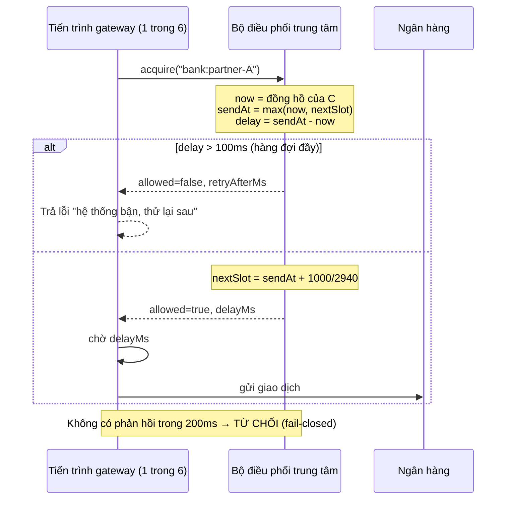

# Bài tập 8 – Chọn thuật toán giới hạn cho cổng thanh toán

Số liệu trong báo cáo được sinh từ mã nguồn:
- `npm run compare`: mô phỏng 5 thuật toán trên cùng một luồng giao dịch, đo bộ nhớ cho 100.000 khoá
- `npm run demo`: 6 tiến trình thật (node:cluster), đột biến 30 giây
- `npm test`: 12 ca kiểm thử

## A. Phân tích và đề xuất đa giải pháp

### A1. Đầu vào / đầu ra

| | |
|---|---|
| **Đầu vào** | Mỗi giao dịch thanh toán chuẩn bị gửi sang ngân hàng: khoá đối tác (`bank:partner-A`), thời điểm đến. Ngoài ra là cấu hình: ngưỡng 3.000/giây, số tiến trình (6), ngân sách bộ nhớ 256MB |
| **Đầu ra** | Với mỗi giao dịch: **cho qua** (kèm thời điểm được phép gửi) hoặc **chặn** (kèm thời gian nên thử lại) |
| **Đặc điểm quan trọng nhất** | Ràng buộc 3.000 là **cứng và tính trên cửa sổ trượt**: "bất kỳ giây nào" nghĩa là mọi đoạn 1 giây [t, t+1s), không chỉ giây đồng hồ. Vượt một lần là mất kết nối 15 phút, thiệt hại lớn hơn rất nhiều so với chặn một ít giao dịch. Trong ràng buộc đó phải tận dụng tối đa 3.000 suất (chặn oan = mất doanh thu), và trạng thái phải **dùng chung giữa 6 tiến trình** |

### A2. Các giải pháp khả thi

| | Ý tưởng | Trạng thái mỗi khoá |
|---|---|---|
| (a) Cửa sổ cố định | Đếm theo giây đồng hồ, đủ 3.000 thì chặn tới giây sau | 2 số |
| (b) Nhật ký cửa sổ trượt | Lưu mốc thời gian mọi giao dịch đã cho qua trong 1s gần nhất | tới 3.000 số |
| (c) Bộ đếm cửa sổ trượt | `prev × phần còn lại + curr` (ước lượng) | 3 số |
| (d) Gáo token | Nạp r token/giây, chứa tối đa C. Để chắc chắn ≤ 3.000 trong mọi 1s thì phải đặt **C + r ≤ 3.000** | 2 số |
| (e) Gáo rò (lập lịch ảo) | Xếp mỗi giao dịch vào khe gửi kế tiếp, các khe cách nhau đúng 1000/r ms. Hàng đợi tối đa 100ms, đầy thì chặn | 1 số (`nextSlot`) |

## B. So sánh và lựa chọn

### B1. Kết quả đo (`npm run compare`)

Kịch bản đột biến 20h-22h: 60s ở 2.000 req/s, 30s ở 5.000 req/s, 30s ở 2.000 req/s, tổng 330.000 giao dịch. Mức chặn tối thiểu bắt buộc (không thể tránh) = 60.027.

| Thuật toán | Cho qua | Bị chặn | Chặn oan | Max / 1s trượt | Vượt 3.000? | Trễ thêm |
|---|---|---|---|---|---|---|
| (a) Cửa sổ cố định | 270.000 | 60.000 | 0 | **3.799** | **VƯỢT** | 0 |
| (b) Nhật ký cửa sổ trượt | 269.973 | 60.027 | 0 | 3.000 | đạt | 0 |
| (c) Bộ đếm cửa sổ trượt | 269.983 | 60.017 | 0 | **3.020** | **VƯỢT** | 0 |
| (d) Gáo token r=2700, C=300 | 261.298 | 68.702 | **8.675** | 2.999 | đạt | 0 |
| (e) Gáo rò r=2990, trễ ≤ 100ms | 269.998 | 60.002 | 0 | 2.991 | đạt | ≤ 100ms |
| (e') Gáo rò r=2940 (cấu hình triển khai) | 268.493 | 61.507 | 1.480 | 2.940 | đạt | ≤ 100ms |

Kịch bản xung lệch biên giây: xung 6.000 req/s kéo dài 1s, bắt đầu giữa giây, lặp 30 lần.

| Thuật toán | Cho qua | Max / 1s trượt | Vượt? |
|---|---|---|---|
| (a) Cửa sổ cố định | 180.000 | **6.000** | **VƯỢT** (gấp đôi) |
| (b) Nhật ký cửa sổ trượt | 90.000 | 3.000 | đạt |
| (c) Bộ đếm cửa sổ trượt | 135.000 | **4.500** | **VƯỢT** |
| (d) Gáo token | 89.970 | 2.999 | đạt |
| (e) Gáo rò r=2990 | **98.670** | 2.991 | đạt (hàng đợi trải xung ra phần trống) |

Bộ nhớ cho 100.000 khoá (đo heap thực tế):

| (a) | (b) | (c) | (d) | (e) |
|---|---|---|---|---|
| 13,4 MB | **2.324 MB** | 14,2 MB | 14,2 MB | 21,1 MB |

### B2. Bảng so sánh ưu – nhược điểm

| Tiêu chí | (a) Cửa sổ cố định | (b) Nhật ký trượt | (c) Bộ đếm trượt | (d) Gáo token | (e) Gáo rò |
|---|---|---|---|---|---|
| Chính xác tại biên | ✗ cho lọt gấp đôi ở biên giây | ✓ tuyệt đối | ✗ chỉ là ước lượng, vượt 0,7% – 50% | ✓ nếu C + r ≤ 3.000 | ✓ tuyệt đối (khe cách đều) |
| Bộ nhớ 100.000 khoá | ✓ ~13 MB | ✗ ~2,3 GB, vượt 256MB gấp 9 lần | ✓ ~14 MB | ✓ ~14 MB | ✓ ~21 MB |
| Chịu tăng đột biến ngắn | Cho lọt (nguy hiểm) | Chặn ngay phần vượt | Cho lọt một phần | Phải giảm r để giữ an toàn, chặn oan 8.675 | **Tốt nhất**: hàng đợi 100ms hấp thu xung, chặn oan ≈ 0 |
| Độ phức tạp khi phân tán | Thấp (`INCR`) | Cao: sorted set, nhiều lệnh, bộ nhớ lớn trên Redis | Trung bình | Trung bình (2 số + thời gian) | **Thấp**: 1 số / khoá, 1 phép so sánh nguyên tử |
| Nhược điểm riêng | – | – | – | Phải hy sinh dung lượng để đổi lấy an toàn | Thêm độ trễ ≤ 100ms |

### B3. Lựa chọn: (e) Gáo rò dạng lập lịch ảo, r = 2.940/giây, trễ tối đa 100ms

Căn cứ theo 3 quy tắc nghiệp vụ:
1. **Tuyệt đối không vượt 3.000**: (a) và (c) bị loại vì số đo vượt ngưỡng (3.799 và 3.020). Gáo rò bảo đảm bằng cấu trúc: hai giao dịch được gửi luôn cách nhau ≥ 1000/r ms, nên trong mọi 1s chỉ có tối đa r giao dịch. Chọn r = 2.940 (biên 2%) để chịu được độ trễ IPC/mạng và sai số bộ hẹn giờ giữa lúc quyết định và lúc gửi thật (khoảng 20ms). Demo đo được: theo lịch tối đa 2.941, gửi thật tối đa **2.984** < 3.000. Nếu không có biên này thì gửi thật sẽ vượt.
2. **Giảm thiểu chặn oan**: ở kịch bản đột biến, gáo rò chặn oan 0 (r=2990) hoặc 1.480 (r=2940, khoảng 2,4% số bị chặn, là cái giá của biên an toàn). Gáo token chặn oan 8.675. Với xung lệch biên, gáo rò cho qua **nhiều hơn cả nhật ký trượt** (98.670 so với 90.000) vì xếp hàng 100ms thay vì chặn ngay. Với thanh toán, trễ thêm 100ms là chấp nhận được, còn bị từ chối thì mất đơn.
3. **6 tiến trình + 256MB**: mỗi khoá chỉ là 1 số, đo được 100.000 khoá ≈ 21MB. Ngân sách 128MB chứa được 524.288 khoá. Nhật ký trượt bị loại vì 100.000 khoá cần ~2,3GB.

**Đợt đột biến 20h-22h**: 2,5 lần lưu lượng = 5.000 req/s, trong đó 2.000 req/s vượt sức chứa vật lý của đối tác nên bắt buộc phải chặn. Không thuật toán nào tránh được phần này. Điều làm được là không chặn thêm phần nào khác: phần ≤ 2.940 req/s đi qua hết, xung ngắn dưới 100ms được hàng đợi hấp thu. Khi đợt đột biến kết thúc, hàng đợi rỗng sau tối đa 100ms và không còn "nợ" sang giây sau (giây 34-35 của demo: chặn 0).

## C. Thiết kế và triển khai

### C1. Các bước xử lý một giao dịch



1. Gateway nhận giao dịch, hỏi bộ điều phối với khoá đối tác.
2. Bộ điều phối (đơn luồng nên nguyên tử) dùng **đồng hồ của chính nó** tính `sendAt = max(now, nextSlot)`.
3. `sendAt - now > 100ms` thì chặn và trả `retryAfterMs`. Ngược lại, dời `nextSlot` thêm một khe rồi trả `delayMs`.
4. Gateway chờ `delayMs` rồi mới gửi sang ngân hàng.

### C2. Đồng bộ bộ đếm giữa 6 tiến trình

- **Một nguồn sự thật duy nhất**: chỉ bộ điều phối giữ `nextSlot`; 6 tiến trình không giữ bộ đếm riêng. Vì vậy bộ cân bằng tải chia lệch (25% / 20% / 15% / 15% / 15% / 10% trong demo) không gây chặn oan như cách chia cứng 500/tiến trình (tiến trình 25% cần 1.250 req/s).
- **Nguyên tử**: mỗi quyết định là một thao tác đọc–so sánh–ghi không bị chen ngang. Bộ điều phối chạy đơn luồng nên không có race.
- **Không phụ thuộc đồng hồ của 6 máy**: chỉ dùng đồng hồ của bộ điều phối.
- **Fail-closed**: mất bộ điều phối thì từ chối (`DistributedLimiter`, timeout 200ms). Không tự cấp hạn mức cục bộ, vì nếu chỉ 1 tiến trình mất kết nối mà tự cho qua 500/s trong khi 5 tiến trình kia vẫn dùng đủ hạn mức chung thì tổng sẽ vượt.
- **Triển khai**: demo dùng tiến trình chủ `node:cluster` làm bộ điều phối (`src/cluster/ipc.ts`). Khi 6 tiến trình nằm trên nhiều máy, đặt cùng thuật toán vào Redis bằng một script Lua (Redis chạy script nguyên tử và có `TIME` dùng chung):

```lua
-- KEYS[1] = khoá đối tác, ARGV[1] = 1000/rate (ms), ARGV[2] = trễ tối đa (ms)
local t = redis.call('TIME')
local now = t[1] * 1000 + t[2] / 1000
local nextSlot = tonumber(redis.call('GET', KEYS[1]) or now)
local sendAt = math.max(now, nextSlot)
local delay = sendAt - now
if delay > tonumber(ARGV[2]) then return {0, tostring(nextSlot - ARGV[2] - now)} end
redis.call('SET', KEYS[1], tostring(sendAt + ARGV[1]), 'PX', math.ceil(delay + ARGV[1]) + 1000)
return {1, tostring(delay)}
```

### C3. Xử lý hai bẫy dữ liệu

| Bẫy | Cách xử lý trong mã | Bằng chứng |
|---|---|---|
| Đột biến 2,5 lần trong 30s (20h-22h) | `LeakyBucket.schedule`: khe cách đều 1000/2940 ms bảo đảm trần cứng; hàng đợi `maxDelayMs = 100` hấp thu xung ngắn; đột biến không để lại nợ cho giây sau | Test `BAY 1`; demo 30s: gửi thật tối đa 2.984 / 1s trượt, giai đoạn bình thường chặn 0 |
| Bộ nhớ 256MB | Mỗi khoá chỉ 1 số. `Coordinator` tính `maxKeys` từ ngân sách 128MB (một nửa cho runtime). Khi đầy thì dọn khoá có hàng đợi rỗng (trạng thái giống khoá mới, xoá an toàn); vẫn đầy thì **từ chối** chứ không cấp phát vượt ngân sách | Test `BAY 2` (100.000 khoá < 64MB, dọn/từ chối khi đầy); demo: RSS tiến trình điều phối ≈ 57MB |

Kết quả demo (`npm run demo`, rút gọn):

```
6 tien trinh, ty le chia tai 0.25 / 0.2 / 0.15 / 0.15 / 0.15 / 0.1, nguong 3000 req/s
Gao ro: r = 2940 giao dich/giay, tre toi da 100ms
giay | giai doan        | gui    | cho qua | bi chan
   3 | binh thuong      |   2000 |    2000 |       0
   5 | dot bien x2.5    |   4985 |    2917 |    2068
  ...
  33 | dot bien x2.5    |   5052 |    2971 |    2081
  34 | binh thuong      |   1999 |    1999 |       0
Tong 35s: gui 159994, cho qua 98458, bi chan 61536
Lon nhat trong 1 giay truot bat ky - theo lich bo dieu phoi : 2941
Lon nhat trong 1 giay truot bat ky - thoi diem gui THAT     : 2984 (nguong 3000) -> DAT
Do tre them toi da cua mot giao dich: 113ms
Bo nho tien trinh dieu phoi: heap 13.9MB, rss 57.5MB (gioi han 256MB)
```

### C4. Cấu trúc mã nguồn

```
src/limiter/leaky-bucket.ts        thuật toán đã chọn (1 khoá)
src/limiter/coordinator.ts         bộ điều phối trung tâm: nhiều khoá, ngân sách bộ nhớ, dọn khoá
src/limiter/distributed-limiter.ts phía gateway: hỏi điều phối, chờ khe, fail-closed
src/limiter/window-stats.ts        đo số giao dịch lớn nhất trong 1s trượt bất kỳ
src/cluster/ipc.ts, demo.ts        6 tiến trình thật + bộ điều phối qua IPC
src/compare/*                      5 thuật toán và mô phỏng so sánh
```
