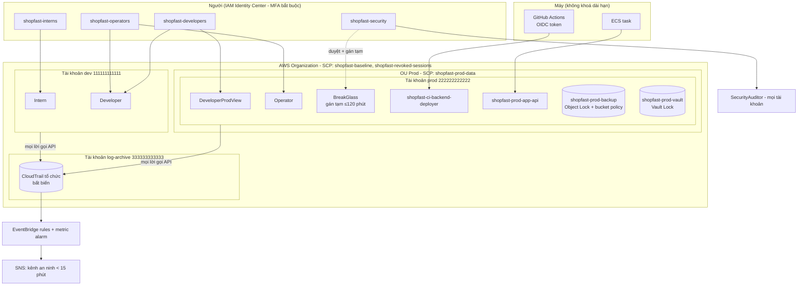
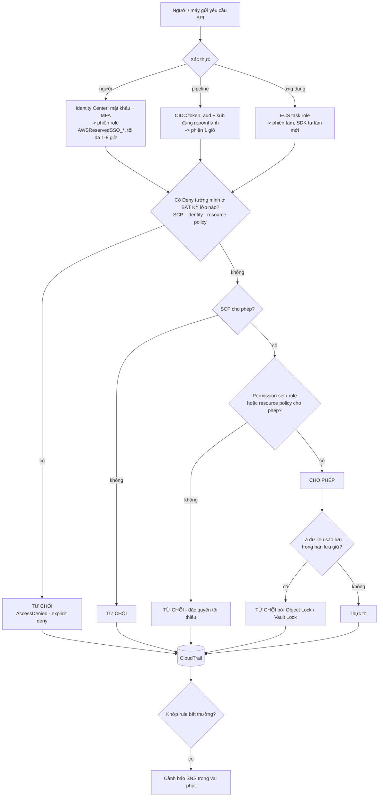

# Bài tập 9 - Nền tảng quản trị truy cập cloud cho ShopFast

> "Tháng trước một bạn thực tập xoá nhầm bucket sao lưu, và chúng ta mất 4 tiếng mới biết ai làm. Tôi muốn hệ thống mà một người mới vào không thể phá được thứ gì quan trọng." - Giám đốc kỹ thuật

## Cấu trúc thư mục (tách chính sách / vai trò / quy trình)

```
ex5/
├── bao-cao.md                          # kiến trúc, ma trận phân quyền, bản đặc tả
├── policies/                           # PHẦN CHÍNH SÁCH
│   ├── scp/                            #   lớp tổ chức (AWS Organizations)
│   │   ├── scp-baseline.json           #     mọi tài khoản: cấm khoá dài hạn, bảo vệ nhật ký, cấm root
│   │   ├── scp-prod-data-protection.json #   OU Prod: chỉ BreakGlass phá huỷ dữ liệu; sao lưu bất khả xâm phạm
│   │   └── scp-revoked-sessions.json   #     cắt tức thì phiên của người bị thu hồi
│   ├── permission-sets/                #   chính sách inline của từng vai trò người
│   ├── resource/                       #   bucket policy, Object Lock
│   └── aws-managed/                    #   bản sao chính sách AWS - chỉ để mô phỏng
├── roles/                              # PHẦN VAI TRÒ
│   ├── permission-sets.json            #   vai trò người: nhóm -> permission set -> tài khoản, thời hạn phiên
│   ├── ci-deployer.{trust,permissions}.json   # pipeline (OIDC)
│   └── app-runtime.{trust,permissions}.json   # ứng dụng (ECS task role)
├── processes/                          # PHẦN QUY TRÌNH
│   ├── runbook-cap-quyen.md
│   ├── runbook-thu-hoi-quyen.md
│   ├── runbook-break-glass.md
│   └── scripts/deploy-platform.sh | grant-access.sh | revoke-access.sh | break-glass.sh
├── detection/                          # ghi nhật ký + phát hiện bất thường < 15 phút
│   ├── eventbridge/*.json
│   ├── access-denied-metric-filter.json
│   └── setup-detection.sh
└── demo/
    ├── run-demo.js, sim/iam-sim.js     # demo offline (node demo/run-demo.js)
    ├── ket-qua-demo.txt
    └── demo-aws.sh                     # demo trên AWS thật
```

---

## 1. Bản đặc tả ngắn: từ yêu cầu mơ hồ đến vai trò và lớp kiểm soát

Phát biểu của giám đốc kỹ thuật chứa **ba vấn đề khác nhau**, mỗi vấn đề cần một loại kiểm soát riêng:

| Câu nói | Vấn đề thực sự | Thu hẹp thành | Lớp kiểm soát chọn |
|---|---|---|---|
| "bạn thực tập xoá nhầm bucket sao lưu" | Người mới có quyền **phá huỷ** trên prod; bản sao lưu **xoá được** | (1) Quyền theo vai trò, người mới chỉ ở dev. (2) Không vai trò thường trực nào có quyền xoá dữ liệu prod. (3) Bản sao lưu bất biến với mọi người. | Đặc quyền tối thiểu (permission set) + SCP + Object Lock / Vault Lock |
| "mất 4 tiếng mới biết ai làm" | Tài khoản dùng chung / không có nhật ký / không có cảnh báo | Mỗi người một danh tính SSO; nhật ký tập trung bất biến; cảnh báo thao tác phá huỷ trong < 15 phút | CloudTrail tổ chức + EventBridge + GuardDuty |
| "người mới vào không thể phá được thứ gì quan trọng" | Cấp quyền tuỳ tiện, không chuẩn | Vai trò cố định, cấp/thu hồi bằng script có người duyệt; "quan trọng" = **dữ liệu prod + sao lưu + nhật ký + cấu hình bảo mật** | Runbook + script + SCP bảo vệ rào chắn |

**Tại sao chọn những thứ đó**
- **IAM Identity Center thay vì IAM user**: không có mật khẩu/khoá dài hạn cho người, MFA bắt buộc tập trung, phiên tự hết hạn, thu hồi một chỗ cho mọi tài khoản.
- **Tách tài khoản dev / prod / log-archive**: ranh giới cứng nhất của AWS - người mới chỉ được gán vào tài khoản dev, nên về mặt kỹ thuật **không có đường nào** chạm prod.
- **SCP làm lớp thứ hai**: SCP không thể bị gỡ từ bên trong tài khoản prod. Dù ai đó lỡ gắn `AdministratorAccess` cho một role, dữ liệu prod vẫn không xoá được.
- **Phá huỷ = thao tác hai người, có hẹn giờ**: chấp nhận rằng đôi khi *phải* xoá, nhưng qua BreakGlass có người duyệt khác, tối đa 2 giờ, cả đội nhận cảnh báo.
- **Bản sao lưu bất biến**: lớp cuối cùng không phụ thuộc IAM - Object Lock COMPLIANCE và Backup Vault Lock không ai (kể cả root) rút ngắn được.
- **Không khoá dài hạn cho máy**: pipeline dùng OIDC (bài 6), ứng dụng dùng task role (bài 8); SCP cấm `CreateUser`/`CreateAccessKey` ở mọi tài khoản để điều này không bị phá vỡ về sau.

---

## 2. Kiến trúc

### 2.1. Sơ đồ mô hình phân quyền



### 2.2. Luồng đánh giá một yêu cầu truy cập



### 2.3. Ma trận phân quyền đầy đủ

| Vai trò | Ai | Tài khoản | Dịch vụ / hành động được phép | Phạm vi tài nguyên | Điều kiện | Không bao giờ được |
|---|---|---|---|---|---|---|
| **Intern** | Thực tập sinh, nhân viên tuần đầu | dev | Xem cấu hình (`ViewOnlyAccess`); S3 `List/Get/PutObject`; đọc log; cập nhật/gọi Lambda | `shopfast-dev-sandbox-*`, `/shopfast/dev/*`, Lambda `shopfast-dev-*` có thẻ `Owner` = chính mình | MFA; phiên 4 giờ | Mọi thứ ở prod; xoá bucket; đổi cấu hình dùng chung |
| **Developer** | Lập trình viên (+ vận hành) | dev | `PowerUserAccess` (mọi dịch vụ trừ IAM/Organizations) | Toàn bộ tài khoản dev | MFA; phiên 8 giờ | IAM; tạo user/khoá |
| **DeveloperProdView** | Lập trình viên | prod | Xem cấu hình (`ViewOnlyAccess`, không đọc dữ liệu); đọc + truy vấn log ứng dụng | log group `/shopfast/prod/app/*` | MFA; phiên 4 giờ | Đọc dữ liệu khách hàng; mọi thao tác ghi |
| **Operator** | Kỹ sư vận hành | prod | Start/Stop/Reboot EC2, cập nhật ECS service, autoscaling; reboot/snapshot/modify RDS; chạy backup + restore; SSM session; alarm; đọc log | Tài nguyên thẻ `Environment=prod`, RDS `shopfast-prod-*`, chỉ PassRole `shopfast-platform-backup-service` cho Backup | MFA; phiên 4 giờ | `Delete*`, `Terminate*` dữ liệu/máy chủ (cả SCP chặn xoá dữ liệu) |
| **SecurityAuditor** | Nhóm an ninh | dev, prod, log-archive | `SecurityAudit` + `ViewOnlyAccess`; tra CloudTrail, GuardDuty, Access Analyzer, Athena; đọc bucket nhật ký | Mọi tài khoản | MFA; phiên 8 giờ | Sửa tài nguyên; **là người duyệt BreakGlass** |
| **BreakGlass** | Người được duyệt theo ticket | prod | `PowerUserAccess` - bao gồm xoá dữ liệu prod | Tài khoản prod **trừ** sao lưu, nhật ký | Gán tạm ≤ 120 phút bởi người khác thuộc `shopfast-security`; phiên 1 giờ; cảnh báo tức thì | Xoá sao lưu (SCP + bucket policy + Object Lock); tắt nhật ký; IAM |
| **CI deployer** (máy) | GitHub Actions `shopfast/backend` nhánh `main` | prod | Đẩy image ECR; đăng ký task definition; cập nhật **một** ECS service; PassRole 2 role của service | `repository/shopfast/backend`, `service/shopfast-prod/backend-api` | OIDC `aud` + `sub` chính xác; phiên 1 giờ | Mọi thứ khác |
| **App runtime** (máy) | Task ECS `backend-api` | prod | S3 get/put media; xoá **chỉ** `tmp/*`; DynamoDB item trên 1 bảng; đọc 1 bí mật | `shopfast-prod-media`, `shopfast-prod-orders`, `shopfast/prod/db-app` | Chỉ ECS của đúng tài khoản | Xoá dữ liệu thật, quản trị bảng |

Áp dụng cho **mọi** vai trò (SCP): không tạo IAM user / access key / login profile; không tắt CloudTrail, GuardDuty, rule EventBridge; không dùng root; không sửa role `shopfast-prod-app-*`, `shopfast-platform-*`, `shopfast-ci-*` (chỉ IaC được sửa).

### 2.4. Đối chiếu ràng buộc kỹ thuật

| Ràng buộc | Đáp ứng bằng | Bằng chứng trong demo |
|---|---|---|
| ≥ 4 vai trò, ranh giới rõ, đặc quyền tối thiểu | 6 vai trò người + 2 vai trò máy, ma trận 2.3 | A1-A7 được phép, B1-B6 bị chặn ngầm định |
| Phá huỷ dữ liệu prod qua ≥ 2 lớp kiểm soát | (1) không vai trò thường trực nào có quyền xoá; (2) BreakGlass hai người + hẹn giờ; (3) SCP `OnlyBreakGlassMayDestroyProdData`; (4) sao lưu bất biến; (5) cảnh báo | C1-C4; Phần 5 cho thấy SCP, identity và resource policy **mỗi lớp tự chặn được** sự cố gốc |
| Không khoá dài hạn cho ứng dụng và pipeline | OIDC, task role; SCP cấm `CreateUser`/`CreateAccessKey` | M1-M3, C5 |
| Nhật ký + phát hiện bất thường < 15 phút | CloudTrail tổ chức (Object Lock), data event S3 prod, 4 rule EventBridge (thao tác phá huỷ, hoạt động BreakGlass, can thiệp rào chắn/root, GuardDuty ≥ 7), alarm AccessDenied ≥ 10/5 phút | `detection/`; C6 (không tắt được nhật ký) |
| Quy trình cấp/thu hồi chuẩn hoá, chạy được | 3 runbook + 4 script; người duyệt ≠ người thực hiện; thu hồi cắt phiên tức thì bằng SCP | C8 |
| Tổ chức cấu hình rõ ràng | `policies/` · `roles/` · `processes/` (+ `detection/`, `demo/`) | Cây thư mục ở đầu tài liệu |

---

## 3. Triển khai

```bash
# Từ tài khoản management, role shopfast-platform-iac
bash processes/scripts/deploy-platform.sh      # SCP, bucket sao lưu, permission sets, role máy, detection
```

Vận hành hằng ngày: xem `processes/runbook-cap-quyen.md`, `runbook-thu-hoi-quyen.md`, `runbook-break-glass.md`.

---

## 4. Kịch bản demo

Chạy offline: `node demo/run-demo.js` (kết quả đầy đủ trong `demo/ket-qua-demo.txt`). Trên AWS thật: `bash demo/demo-aws.sh`.

### 4.1. Thao tác được phép
| ID | Ai | Thao tác | Kết quả | Quyết định bởi |
|---|---|---|---|---|
| A1 | Intern@dev | Ghi file vào `shopfast-dev-sandbox-binh` | ALLOW | `Intern-inline#SandboxObjectsReadWrite` |
| A4 | Operator@prod | Reboot RDS `shopfast-prod-main` | ALLOW | `Operator-inline#DatabaseCareNotDeletion` |
| A6 | App role | Xoá `shopfast-prod-media/tmp/...` | ALLOW | `CleanupOnlyTemporaryUploads` (SCP miễn trừ role ứng dụng có phạm vi hẹp) |
| A7 | BreakGlass@prod | Xoá bảng `shopfast-prod-legacy-carts` | ALLOW | `PowerUserAccess`, đã qua duyệt hai người |

### 4.2. Thao tác bị chặn bởi đặc quyền tối thiểu
| ID | Ai | Thao tác | Kết quả |
|---|---|---|---|
| B1 | Intern@prod | Đọc dữ liệu khách hàng | DENY ngầm định - Intern không có gán nào ở prod |
| B2 | Intern@dev | Xoá bucket dùng chung `shopfast-dev-assets` | DENY ngầm định |
| B3 | DeveloperProdView | Đọc dữ liệu khách hàng prod | DENY ngầm định - `ViewOnlyAccess` không đọc dữ liệu |
| B5 | Operator@prod | Huỷ máy chủ prod | DENY ngầm định |
| B6 | App role | Xoá ảnh sản phẩm thật | DENY ngầm định - chỉ được xoá `tmp/*` |

### 4.3. Thao tác bị chặn bởi lớp kiểm soát bổ sung (identity đã cho phép)
| ID | Ai | Thao tác | Kết quả | Lớp chặn |
|---|---|---|---|---|
| C1 | Role lỡ gắn `AdministratorAccess` | Xoá bucket prod | DENY tường minh | SCP `OnlyBreakGlassMayDestroyProdData` |
| C3 | BreakGlass | Xoá file trong `shopfast-prod-backup` | DENY tường minh | Bucket policy `NobodyDeletesBackups` (+ Object Lock) |
| C4 | BreakGlass | Xoá bucket sao lưu | DENY tường minh | SCP `BackupsCannotBeDestroyedByAnyone` **và** bucket policy |
| C5 | Role admin | Tạo access key | DENY tường minh | SCP `NoLongTermCredentialsAnywhere` |
| C6 | Role admin | Tắt CloudTrail | DENY tường minh | SCP `ProtectAuditAndDetection` |
| C8 | Developer vừa bị thu hồi (phiên cũ còn hạn) | Ghi S3 | DENY tường minh | SCP `shopfast-revoked-sessions` |

### 4.4. Tái hiện sự cố gốc
Thực tập sinh chạy `aws s3api delete-bucket --bucket shopfast-prod-backup`:

| Lớp | Tự nó có chặn được? |
|---|---|
| Đặc quyền tối thiểu - Intern không có quyền nào ở prod | Có (Deny ngầm định) |
| SCP OU Prod | Có (Deny tường minh) |
| Bucket policy sao lưu | Có (Deny tường minh) |
| Object Lock COMPLIANCE 35 ngày | Có (bucket không thể rỗng nên không thể xoá) |
| Phát hiện | Cảnh báo trong vài phút, CloudTrail ghi email người thực hiện - thay vì 4 tiếng |

Bốn lớp độc lập: một lớp bị cấu hình sai thì sự cố vẫn không lặp lại.
