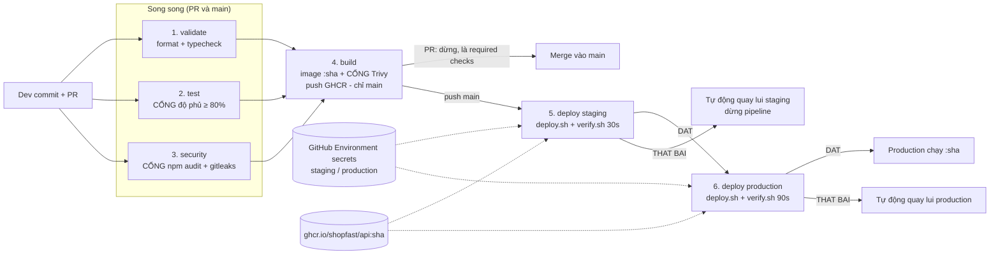

# Bài tập 9 – Nền tảng triển khai tự động cho ShopFast

## 1. Bản đặc tả ngắn – thu hẹp yêu cầu mở

**Yêu cầu gốc**: “Mỗi lần triển khai là một buổi tối căng thẳng… Tôi muốn triển khai trở thành việc nhàm chán.”

Nguyên nhân gây căng thẳng và cách hệ thống xử lý:

| Nguyên nhân | Cách xử lý | Thể hiện ở |
|---|---|---|
| Không chắc mã có chạy không | Kiểm thử tự động có **cổng độ phủ** (lines ≥ 80%) | Giai đoạn 2 |
| Sợ đưa lỗ hổng / lộ khoá lên production | **Cổng bảo mật**: `npm audit` (high+), gitleaks, Trivy quét image | Giai đoạn 3, 4 |
| Triển khai tay, mỗi người làm một kiểu | Một pipeline duy nhất, mọi bước là code | `.github/workflows/` |
| Không biết bản mới có ổn không | **Tiêu chí đo được** sau triển khai (health, tỉ lệ lỗi, p95) | `deploy/verify.sh` |
| Có lỗi thì phải thức khuya sửa tay | **Tự động quay lui** về bản trước, không cần người | `deploy/deploy.sh` |
| Lỗi lọt thẳng ra người dùng thật | Đi qua **staging** với cùng quy trình trước khi lên production | Giai đoạn 5 → 6 |

**Phạm vi**: 1 dịch vụ API (Node/TypeScript), 2 môi trường (staging, production), GitHub Actions + GHCR, server Docker Compose.
**Không nằm trong phạm vi**: hạ tầng Kubernetes, quan sát hệ thống đầy đủ (Prometheus/Grafana) – `verify.sh` dùng `/health` và `/metrics` của ứng dụng là đủ cho tiêu chí quay lui.

**Vì sao chọn các cổng này**

- *Độ phủ ≥ 80%*: là ngưỡng đo được ngay trong CI, không cần công cụ ngoài; chặn được trường hợp phổ biến nhất là thêm tính năng mà không viết test.
- *npm audit + Trivy*: hai lớp – lỗ hổng trong phụ thuộc JS và lỗ hổng trong image nền (Alpine/Node). Chỉ chặn HIGH/CRITICAL đã có bản vá (`--ignore-unfixed`) để cổng không chặn vô cớ.
- *gitleaks*: bảo đảm ràng buộc “không có giá trị nhạy cảm trong mã nguồn” được kiểm tra bằng máy chứ không chỉ bằng quy ước.

## 2. Thiết kế kiến trúc

### 2.1. Sơ đồ toàn bộ pipeline từ commit tới production



Luồng dữ liệu: mã nguồn → (CI) → image bất biến `ghcr.io/shopfast/api:<sha>` → cùng một image được kéo về staging rồi production. Cấu hình không nằm trong image: `config/shared.env` + `config/<env>.env` (không nhạy cảm, trong git) và `.env` (bí mật, ghi từ GitHub Environment secrets lúc triển khai).

### 2.2. Bảng các giai đoạn

| # | Giai đoạn | Đầu vào | Đầu ra | Tiêu chí thành công | Khi thất bại | Timeout |
|---|---|---|---|---|---|---|
| 1 | `validate` | Mã nguồn tại commit | – | `prettier --check` và `tsc --noEmit` không lỗi | Job đỏ, build không chạy, PR bị khoá merge | 3 phút |
| 2 | `test` – **cổng chất lượng** | Mã nguồn | Báo cáo độ phủ (step summary) | 100% test qua **và** lines/statements/functions ≥ 80%, branches ≥ 70% | Job đỏ, build không chạy, PR bị khoá merge | 5 phút |
| 3 | `security` – **cổng bảo mật** | Mã nguồn + toàn bộ lịch sử git | – | `npm audit --audit-level=high --omit=dev` = 0 lỗ hổng; gitleaks không thấy bí mật | Job đỏ, build không chạy | 3 phút |
| 4 | `build` – **cổng bảo mật image** | Mã nguồn đã qua 1–3 | Image `ghcr.io/shopfast/api:<sha>` (chỉ đẩy khi push main) | Build thành công; Trivy không có HIGH/CRITICAL đã có bản vá | Image **không** được đẩy, pipeline dừng | 6 phút |
| 5 | `deploy-staging` | Image `<sha>`, `shared.env` + `staging.env`, secrets staging | Staging chạy `<sha>` | `verify.sh` 30 s: health không lỗi ≥ 3 lần liên tiếp, đúng version, tỉ lệ lỗi ≤ 5%, p95 ≤ 800 ms | **Tự động quay lui** staging, job đỏ, production không chạy | 5 phút |
| 6 | `deploy-production` | Cùng image `<sha>`, `shared.env` + `production.env`, secrets production | Production chạy `<sha>` | `verify.sh` 90 s, ngưỡng lỗi chặt hơn ≤ 2% | **Tự động quay lui** production, job đỏ, báo `::error::` | 5 phút |

### 2.3. Ngân sách thời gian (< 10 phút)

| Đoạn | Ước tính | Ghi chú |
|---|---|---|
| 1, 2, 3 chạy song song | ~1,5–2 phút | `npm ci` dùng cache `~/.npm` |
| 4 build + Trivy + push | ~2 phút | Buildx cache `type=gha`; image Alpine ~50 MB nén |
| 5 staging | ~1 phút | pull + up ~15 s, verify 30 s (thực đo ~28 s cho 20 s cấu hình) |
| 6 production | ~2 phút | pull + up ~15 s, verify 90 s |
| **Tổng** | **~7–7,5 phút** | Trường hợp xấu nhất có quay lui: + ~25 s (thực đo 21 s) |

Mỗi job có `timeout-minutes`, nên một bước bị treo không làm pipeline kéo dài vô hạn.

### 2.4. Cơ chế quay lui tự động

`deploy.sh` (chạy trên server) → đổi container sang `<sha>` mới → `verify.sh`. Tiêu chí phát hiện lỗi (chỉ cần **một** điều kiện là quay lui):

| # | Tiêu chí | Ngưỡng mặc định | Production |
|---|---|---|---|
| 1 | `/health` lỗi **liên tiếp** | ≥ 3 lần (3 giây) | ≥ 3 lần |
| 2 | `/health` trả version khác `<sha>` vừa triển khai | bất kỳ | bất kỳ |
| 3 | Tỉ lệ lỗi probe (`/products`, `/products/1`: 5xx hoặc lỗi kết nối) | > 5% | > 2% |
| 4 | Độ trễ p95 của probe | > 800 ms | > 800 ms |
| 5 | Tỉ lệ 5xx của lưu lượng **thật** (`/metrics`, so trước/sau thời gian quan sát) | > 5% | > 2% |

Khi không đạt: `docker compose up` lại tag trong `state/current_tag`, chạy lại `verify.sh` 10 s cho bản cũ, ghi `state/history.log`, thoát mã **2** → GitHub Actions báo `::error::Verify that bai - da TU DONG QUAY LUI…` và dừng pipeline (không lên production nếu lỗi ở staging).

### 2.5. Tổ chức cấu hình

| Loại | Nơi | Ví dụ |
|---|---|---|
| **Dùng chung** | `config/shared.env` | `IMAGE`, `CONTAINER_PORT`, ngưỡng verify mặc định |
| **Riêng từng môi trường** (ghi đè phần dùng chung) | `config/staging.env`, `config/production.env` | `APP_URL`, `MEM_LIMIT`, `LOG_LEVEL`, `VERIFY_DURATION_SECONDS`, `VERIFY_MAX_ERROR_RATE` |
| **Biến số mỗi lần chạy** | Tham số pipeline | `IMAGE_TAG = github.sha` |
| **Bí mật** | GitHub Environment secrets `staging` / `production` | `JWT_SECRET`, `SSH_HOST`, `SSH_USER`, `SSH_PRIVATE_KEY`, `SSH_KNOWN_HOSTS` |
| **Logic dùng chung** | `.github/workflows/_deploy.yml` (reusable) | Giai đoạn 5 và 6 gọi cùng một workflow, chỉ khác input `environment` |
| **Ngưỡng cổng chất lượng** | `package.json` → `jest.coverageThreshold` | Một nơi duy nhất, chạy giống nhau ở máy dev và CI |

Thứ tự nạp trên server (`deploy.sh`): `shared.env` → `env.env` (bản riêng của môi trường, ghi đè) → `IMAGE_TAG`. Bí mật nằm trong `.env` quyền `600`, chỉ được truyền vào container qua `env_file`, không bao giờ có trong git hay trong image.

## 3. Sản phẩm

```
ex5/
├── .github/workflows/
│   ├── pipeline.yml          # 6 giai đoạn
│   └── _deploy.yml           # dùng chung cho giai đoạn 5, 6
├── config/
│   ├── shared.env            # dùng chung
│   ├── staging.env           # riêng staging
│   └── production.env        # riêng production
├── deploy/
│   ├── docker-compose.yml
│   ├── deploy.sh             # triển khai + tự động quay lui
│   └── verify.sh             # tiêu chí phát hiện lỗi
├── demo/
│   ├── 1-trien-khai-thanh-cong.sh
│   ├── 2-bi-cong-chan.sh
│   └── 3-quay-lui-tu-dong.sh
├── logs/                     # kết quả chạy thử thật
├── src/  (app.ts, metrics.ts, token.ts, main.ts)
├── test/ (app.test.ts, unit.test.ts)
├── Dockerfile
└── package.json              # coverageThreshold
```

Thiết lập một lần trên GitHub:

1. Tạo Environments `staging`, `production` và thêm các secrets ở mục 2.5.
2. Branch protection cho `main`: required checks `validate`, `test`, `security`, `build`.
3. Trên mỗi server: `mkdir /opt/shopfast` cho user deploy (có quyền chạy docker).

## 4. Kịch bản demo

| Demo | Cách chạy | Kết quả mong đợi |
|---|---|---|
| 1. Triển khai thành công | `demo/1-trien-khai-thanh-cong.sh` → merge PR | 6 giai đoạn xanh; staging và production in `DAT: phien ban <sha> on dinh` |
| 2. Bị cổng kiểm soát chặn | `demo/2-bi-cong-chan.sh` | `test` đỏ (độ phủ < 80%), `security` đỏ (lodash high), `build` bị bỏ qua, nút Merge khoá |
| 3. Quay lui tự động | `demo/3-quay-lui-tu-dong.sh` → merge PR | CI xanh (lỗi chỉ xảy ra khi `NODE_ENV=production`), staging: `THAT BAI: ti le loi probe 50% > 5%` → `TU DONG QUAY LUI`, production không chạy |

### Kết quả chạy thử thật trên máy cục bộ

Chạy đúng các script `deploy.sh` / `verify.sh` với Docker và một registry cục bộ (`localhost:5000`) thay cho GHCR; cấu hình staging, thời gian quan sát rút xuống 20 s.

**Demo 1 – thành công** (`logs/demo-1-deploy-success.log`):

```
[deploy] staging: v1 -> v2
[verify] Probe: 40 request, 0 loi (0%), p95 21ms
[verify] Luu luong that (/metrics): 65 request, 0 loi 5xx (0%)
[verify] DAT: phien ban v2 on dinh
[deploy] Trien khai v2 thanh cong
```

**Demo 2 – bị cổng chặn** (`logs/demo-2-gate-blocked.log`):

```
$ npm run test:coverage   # thêm src/coupon.ts không có test
Lines        : 76.19% ( 64/84 )
Jest: "global" coverage threshold for lines (80%) not met: 76.19%
exit code: 1

$ npm audit --audit-level=high --omit=dev   # thêm lodash@4.17.20
lodash  <=4.17.23
Severity: high
1 high severity vulnerability          -> exit code 1
```

**Demo 3 – quay lui tự động** (`logs/demo-3-auto-rollback.log`):

```
[deploy] staging: v2 -> v3
[verify] Probe: 40 request, 20 loi (50%), p95 5ms
[verify] Luu luong that (/metrics): 65 request, 20 loi 5xx (30%)
[verify] THAT BAI: ti le loi probe 50% > 5%
[verify] THAT BAI: ti le 5xx that 30% > 5%
[deploy] TU DONG QUAY LUI ve v2
[verify] DAT: phien ban v2 on dinh
[deploy] Da quay lui ve v2 sau 21s          -> exit code 2
```

`state/history.log` trên server sau 3 lần chạy:

```
OK v1
OK v2
FAIL v3
ROLLBACK v3 -> v2
```
