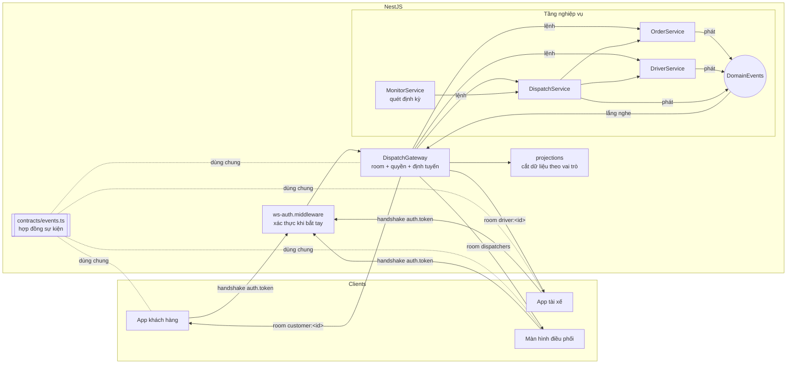

# Bài tập 9 – Trung tâm điều phối giao hàng thời gian thực

## 1. Bản đặc tả ngắn – thu hẹp yêu cầu mở

Yêu cầu gốc của giám đốc vận hành: *“nhìn một màn hình là biết đơn nào đang tắc ở đâu, tài xế nào đang rảnh, và can thiệp được ngay khi cần.”* Câu này được tách thành 3 nhu cầu, mỗi nhu cầu thành các tình huống cụ thể:

| Nhu cầu | Tình huống cụ thể được chọn | Cách phát hiện / xử lý |
|---|---|---|
| **Biết đơn nào đang tắc, tắc ở đâu** | T1. Đơn **chờ gán** quá lâu (không ai nhận) | Monitor quét định kỳ: `pending` quá `pendingLimitMs` (5 phút) → cảnh báo `ORDER_STUCK` |
| | T2. Tài xế **từ chối** đơn | Ngay khi từ chối → đơn về hàng chờ, cảnh báo `DRIVER_REJECTED` |
| | T3. Tài xế **không phản hồi** đề nghị nhận đơn | `offered` quá `offerTimeoutMs` (60s) → tự thu hồi, đơn về hàng chờ, cảnh báo `OFFER_TIMEOUT` |
| | T4. Tài xế đang giao nhưng **im lặng** (không gửi vị trí/tiến độ) | `accepted/picked_up` mà quá `silentLimitMs` (3 phút) không có tín hiệu → `DRIVER_SILENT` |
| | T5. Tài xế đang giữ đơn thì **mất kết nối** | Thiết bị cuối cùng ngắt → `DRIVER_DISCONNECTED`, tài xế hiện `offline` |
| **Biết tài xế nào đang rảnh** | T6. Bảng tài xế realtime: `offline / off_duty / available / busy` + vị trí | Tài xế bật/tắt nhận đơn, gửi GPS; kết nối/ngắt tự cập nhật; ping 10s + timeout 5s phát hiện máy tắt |
| **Can thiệp được ngay** | T7. Gán đơn cho tài xế rảnh | `dispatch:assign`, server kiểm tra tài xế phải `available` |
| | T8. **Gán lại** đơn đang tắc sang tài xế khác | Cùng `dispatch:assign`; tài xế cũ nhận `driver:task_revoked` |

**Vì sao chọn những tình huống này**
- Chúng bao trọn vòng đời một đơn (chờ gán → đề nghị → nhận → lấy hàng → giao), và mỗi điểm “kẹt” của vòng đời có đúng một cảnh báo.
- Đều đo được bằng dữ liệu sẵn có (trạng thái, mốc thời gian, tín hiệu từ app tài xế), không phải đoán.
- Mỗi cảnh báo đi kèm một hành động can thiệp cụ thể (gán/gán lại).

Ngoài phạm vi (không làm): huỷ đơn, tối ưu tuyến, tự động gán, lịch sử/báo cáo.

**Hai nhóm người dùng còn lại cần gì**
- **Khách hàng**: chỉ đơn của mình, gồm trạng thái, tên tài xế (sau khi tài xế đã nhận) và vị trí tài xế khi đang giao đơn đó.
- **Tài xế**: chỉ đơn được giao cho mình, gồm điểm lấy, điểm giao và tên người nhận.

## 2. Kiến trúc



| Thư mục | Vai trò |
|---|---|
| `src/contracts/events.ts` | **Hợp đồng sự kiện**: tên sự kiện, kiểu payload, quyền gửi theo vai trò (`C2S_ROLES`) |
| `src/auth/` | Phát hành và kiểm tra token HMAC có hạn dùng |
| `src/domain/` | **Tầng nghiệp vụ**: không biết gì về socket/room. Chỉ thay đổi trạng thái rồi phát `DomainEvents` |
| `src/gateway/` | **Gateway**: xác thực khi bắt tay, gán room theo vai trò, kiểm quyền, bắt mọi ngoại lệ, định tuyến sự kiện nghiệp vụ tới đúng người qua `projections` |

**Luồng dữ liệu**
1. Client gửi lệnh → gateway kiểm tra vai trò theo `C2S_ROLES`.
2. Gateway gọi service; service thay đổi trạng thái và phát `orderChanged`, `driverChanged`, `driverMoved` hoặc `alert`.
3. Gateway nghe các sự kiện này, cắt dữ liệu theo vai trò (`projections`) và phát vào đúng room.
4. Client gửi nhận kết quả qua ack.

**Room**
- `dispatchers`: mọi điều phối viên.
- `driver:<id>`: mọi thiết bị của một tài xế.
- `customer:<id>`: mọi thiết bị của một khách.

Không có room chung nào cho khách hàng hay tài xế, nên không thể nhận nhầm dữ liệu của người khác.

## 3. Bảng hợp đồng sự kiện

Mọi kết nối phải gửi `auth: { token }` khi bắt tay. Token sai, giả mạo, hết hạn hoặc bị sửa vai trò thì bị từ chối (`UNAUTHORIZED`) trước khi vào bất kỳ room nào.

### Client → Server (mọi sự kiện trả ack `{ ok: true, data } | { ok: false, error }`)

| Sự kiện | Ai gửi | Dữ liệu kèm theo | Kết quả / ai nhận tiếp |
|---|---|---|---|
| `customer:place_order` | Khách | `{ pickup: string, dropoff: string }` (≤ 200 ký tự, không rỗng) | Tạo đơn `pending` → điều phối `dispatch:order_updated`; khách `customer:order_status` |
| `driver:set_status` | Tài xế | `{ status: 'available' \| 'off_duty' }` | Điều phối `dispatch:driver_updated` |
| `driver:location` | Tài xế | `{ lat: number, lng: number }` | Điều phối `dispatch:driver_updated`; khách của đơn đang giao `customer:driver_location` |
| `driver:respond` | Tài xế | `{ orderId: string, accept: boolean }` | Nhận → `accepted`; từ chối → `pending` + `dispatch:alert DRIVER_REJECTED` |
| `driver:progress` | Tài xế | `{ orderId: string, status: 'picked_up' \| 'delivered' }` | Cập nhật tới điều phối, khách, tài xế |
| `dispatch:assign` | Điều phối | `{ orderId: string, driverId: string }` | Đơn `offered` → tài xế `driver:task`; tài xế cũ (nếu gán lại) `driver:task_revoked` |

### Server → Client

| Sự kiện | Ai nhận | Dữ liệu kèm theo |
|---|---|---|
| `dispatch:snapshot` | Điều phối (khi vừa kết nối) | `{ orders: OrderView[], drivers: DriverView[] }` |
| `dispatch:order_updated` | Điều phối | `OrderView { id, customerId, customerName, pickup, dropoff, status, driverId, createdAt, statusSince }` |
| `dispatch:driver_updated` | Điều phối | `DriverView { id, name, availability, location, lastSeenAt, activeOrderId }` |
| `dispatch:alert` | Điều phối | `{ type: 'ORDER_STUCK'\|'OFFER_TIMEOUT'\|'DRIVER_REJECTED'\|'DRIVER_SILENT'\|'DRIVER_DISCONNECTED', orderId, driverId, message, at }` |
| `driver:task` | Đúng tài xế được giao (mọi thiết bị) | `{ orderId, pickup, dropoff, customerName, status }` |
| `driver:task_revoked` | Tài xế bị thu hồi đơn | `{ orderId, reason }` |
| `customer:order_status` | Đúng khách chủ đơn | `{ orderId, status, driverName, updatedAt }` – không có id/địa chỉ/thông tin nội bộ |
| `customer:driver_location` | Đúng khách chủ đơn, chỉ khi đơn `accepted`/`picked_up` | `{ orderId, location: { lat, lng } }` |

Tổng cộng 14 sự kiện, trong đó 6 sự kiện đi từ client lên server.

### Vòng đời đơn

```
pending --assign--> offered --accept--> accepted --picked_up--> picked_up --delivered--> delivered
   ^                  |  \--reject / het han--> pending
   |                  \--assign lai (tai xe khac)--> offered
   \------------------- (ORDER_STUCK neu cho qua lau)
```

## 4. Chịu lỗi & không rò rỉ tài nguyên

- **Ngoại lệ**
  - Mọi handler đi qua `run()`: kiểm quyền rồi `try/catch`.
  - `DomainError` → ack với thông báo thân thiện; lỗi lạ → ghi log và ack “Lỗi hệ thống”. Không bao giờ ném ra ngoài.
  - Listener `DomainEvents` và vòng quét monitor cũng được bọc `try/catch`.
  - `handleConnection` lỗi thì ngắt đúng socket đó.
  - `maxHttpBufferSize` chặn gói tin quá lớn.
- **Mất kết nối bất ngờ**
  - `pingInterval 10s / pingTimeout 5s` phát hiện máy tắt.
  - Socket.IO tự dọn room; `DriverService` đếm số thiết bị và chỉ báo offline khi thiết bị cuối cùng rời đi.
  - Tài xế nối lại sẽ được gửi lại nhiệm vụ đang làm.
  - Đề nghị nhận đơn gửi tới tài xế đã mất kết nối sẽ tự hết hạn (`OFFER_TIMEOUT`), nên đơn không bị treo.
- **Không rò rỉ**
  - Gateway không giữ map socket nào.
  - Monitor chỉ giữ 1 mốc cảnh báo cho mỗi đơn và xoá khi đơn giao xong.
  - Timer và listener được gỡ trong `onModuleDestroy`.
  - Test `khong ro ri tai nguyen…` kết nối/ngắt 25 lần rồi kiểm tra: 0 socket, 0 room, số listener không đổi, mọi tài xế `connections = 0`.

## 5. Kịch bản demo – 3 vai trò hoạt động đồng thời

`npm run demo` chạy 1 điều phối viên, 2 tài xế và 2 khách hàng cùng lúc. Ngưỡng thời gian được thu nhỏ (giây thay vì phút). Log đầy đủ ở `logs/demo-run.log`.

| Bước | Hành động | Kết quả quan sát được |
|---|---|---|
| 0 | Kết nối không token / token giả | `UNAUTHORIZED: Thieu token`, `UNAUTHORIZED: Token khong hop le` |
| 1 | OP01, D01, D02, C01, C02 kết nối cùng lúc; 2 tài xế bật nhận đơn | Điều phối nhận `snapshot` + từng tài xế `available` |
| 2 | Khách An, Bình đặt đơn | Mỗi khách chỉ nhận trạng thái đơn của mình |
| 3 | Gán DH-0001→Cường (nhận), DH-0002→Dũng (từ chối) | `DRIVER_REJECTED`, Dũng nhận `task_revoked` |
| 4 | DH-0002 chờ quá ngưỡng | `ORDER_STUCK` |
| 5 | Gán DH-0002 cho Cường đang bận | Lỗi: “Tai xe Cuong dang ban don khac” |
| 6 | Gán cho Dũng, Dũng không phản hồi | `OFFER_TIMEOUT`, đơn tự về hàng chờ; gán lại, Dũng nhận |
| 7 | Cường lấy hàng, gửi vị trí | Chỉ Khách An nhận `customer:driver_location` |
| 8 | Cường im lặng rồi mất kết nối | `DRIVER_SILENT`, `DRIVER_DISCONNECTED`, Cường `offline` |
| 9 | Cường nối lại bằng thiết bị mới | Nhận lại `driver:task` DH-0001, giao xong |
| 10 | Khách gọi `dispatch:assign`, gửi dữ liệu rác | Mỗi lỗi có thông báo; server vẫn chạy |
| 11 | Kiểm tra phạm vi | Khách Bình: 0 cập nhật của đơn người khác, 0 vị trí tài xế |

Trích log:

```
[+  0.75s] DieuPhoi   <- dispatch:alert {"type":"DRIVER_REJECTED","message":"Tai xe Dung tu choi don DH-0002",...}
[+  2.96s] DieuPhoi   <- dispatch:alert {"type":"ORDER_STUCK","message":"Don DH-0002 cho gan tai xe qua 2s",...}
[+  3.36s] DieuPhoi   -> dispatch:assign {"orderId":"DH-0002","driverId":"D01"} => LOI: Tai xe Cuong dang ban don khac, khong the nhan don
[+  6.52s] DieuPhoi   <- dispatch:alert {"type":"OFFER_TIMEOUT","message":"Tai xe Dung khong phan hoi don DH-0002, don da ve hang cho",...}
[+ 10.89s] DieuPhoi   <- dispatch:alert {"type":"DRIVER_SILENT","message":"Tai xe Cuong khong cap nhat vi tri/tien do don DH-0001 qua 4s",...}
[+ 11.50s] DieuPhoi   <- dispatch:alert {"type":"DRIVER_DISCONNECTED","message":"Tai xe Cuong mat ket noi khi dang xu ly don DH-0001 (picked_up)",...}
[+ 12.03s] Khach An   -> dispatch:assign {"orderId":"DH-0002","driverId":"D01"} => LOI: Ban khong co quyen thuc hien thao tac nay
[+ 12.03s] KIEM TRA   Khach Binh nhan 7 cap nhat, 0 cap nhat cua don nguoi khac
```

## 6. Chạy

```
npm install
npm test        # 11/11 pass
npm run demo    # kich ban 3 vai tro, ghi logs/demo-run.log
npm start       # server o cong 3000, in token dung thu cho tung nguoi dung
```
