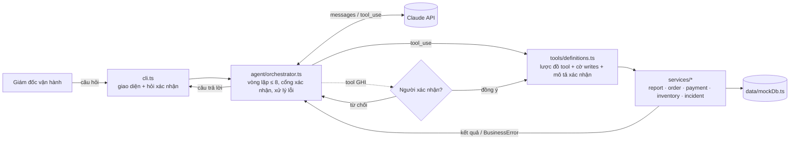

# Bài 9 – Trợ lý vận hành ShopFast

## 1. Bản đặc tả ngắn

**Yêu cầu gốc:** *"Buổi sáng tôi mất một tiếng để biết đêm qua có gì bất thường. Tôi muốn hỏi một câu là ra vấn đề, và nếu cần thì xử lý luôn."*

**Thu hẹp thành 3 tình huống cụ thể** (khung giờ đêm qua 22:00 → sáng nay):

| # | Tình huống bất thường | Cách phát hiện | Cách xử lý agent làm được |
|---|---|---|---|
| 1 | **Thanh toán lỗi tăng vọt** (ví dụ một cổng thanh toán bị sự cố lúc nửa đêm) | Tỷ lệ lỗi cả đêm > 2 lần trung bình 7 ngày, phân tích theo cổng và mã lỗi | Không tự sửa được cổng thanh toán, nên **tạo sự cố** giao đội THANH_TOAN |
| 2 | **Đơn bị kẹt** (chờ xác nhận > 2 giờ mà chưa được đẩy sang kho) | Lọc đơn `CHO_XAC_NHAN` + `pushedToWarehouse = false` | **Đẩy lại** các đơn sang kho |
| 3 | **Tồn kho sai lệch** (bán vượt tồn kho, hoặc hết hàng mà vẫn mở bán) | Sản phẩm đang bán có `available < 0` hoặc `= 0` | **Tạm ngừng bán** sản phẩm |

**Vì sao chọn 3 tình huống này:**

- Đây là 3 nhóm sự cố ban đêm gây thiệt hại trực tiếp vào buổi sáng: mất doanh thu (thanh toán lỗi), khách chờ và giao trễ (đơn kẹt), bán ra hàng không có để giao (oversell).
- Cả 3 đều **đo được bằng số liệu sẵn có** (đơn, thanh toán, tồn kho), không phải đoán, nên agent có thể nói "vấn đề là gì" bằng con số.
- Mỗi tình huống có một hành động xử lý rõ ràng, có thể hoàn tác, và đủ an toàn để làm sau khi người duyệt. Những việc rủi ro cao (hoàn tiền, hủy đơn hàng loạt) cố ý **không** đưa vào phạm vi.

**Ngoài phạm vi:** hoàn tiền, hủy đơn, sửa giá, các khung giờ không phải ban đêm (vẫn hỏi được qua tham số `from`/`to`, nhưng không phải trọng tâm).

## 2. Thiết kế kiến trúc



**Luồng dữ liệu:** câu hỏi → orchestrator gửi lên model kèm danh sách tool → model gọi tool → orchestrator tìm `ToolSpec`. Nếu `writes = true` thì hỏi người xác nhận trước. Service chạy và trả kết quả hoặc `BusinessError` → orchestrator gửi `tool_result` cho model (lỗi thì có `is_error`) → lặp cho tới `end_turn` hoặc đủ 8 vòng → câu trả lời.

**Clean Code, tách 3 phần:**

| Thư mục | Trách nhiệm | Không làm |
|---|---|---|
| `src/tools/` | Định nghĩa tool: tên, mô tả, `input_schema`, cờ ghi/đọc, câu mô tả để xác nhận | Không chứa logic nghiệp vụ |
| `src/services/` | Thực thi nghiệp vụ, kiểm tra dữ liệu đầu vào, ném `BusinessError` | Không biết gì về model hay agent |
| `src/agent/` | Điều phối: vòng lặp, giới hạn 8 vòng, cổng xác nhận, đổi lỗi thành câu thân thiện | Không truy cập dữ liệu trực tiếp |

### Bảng tool

| Tool | Loại | Mục đích | Tham số vào | Dữ liệu ra |
|---|---|---|---|---|
| `get_overnight_summary` | **Tổng hợp** | Một câu hỏi ra toàn cảnh đêm qua + danh sách bất thường | `from?`, `to?` (ISO 8601) | Số đơn, doanh thu, tỷ lệ thanh toán lỗi so với baseline, số đơn kẹt, cảnh báo tồn kho, `anomalies[]` |
| `list_stuck_orders` | Đọc | Liệt kê đơn bị kẹt | `minHours?` (0–72, mặc định 2) | `count`, `orders[{orderId, warehouse, waitingHours, total}]` |
| `get_payment_failures` | Đọc | Phân tích thanh toán lỗi | `from?`, `to?` | Tổng, số lỗi, tỷ lệ, `byGateway{total, failed, failureRate, errors, firstFailure, lastFailure}` |
| `get_stock_alerts` | Đọc | Sản phẩm bán vượt kho / hết hàng / sắp hết | (không) | `oversold[]`, `outOfStock[]`, `lowStock[]` |
| `retry_stuck_orders` | **Ghi** (cần xác nhận) | Đẩy lại đơn kẹt sang kho | `orderIds: string[]` (1–50) | `retried[]`, `skipped[{orderId, reason}]` |
| `pause_product_sales` | **Ghi** (cần xác nhận) | Tạm ngừng bán sản phẩm | `sku`, `reason` | `{sku, name, onSale: false, reason}` |
| `create_incident` | **Ghi** (cần xác nhận) | Tạo sự cố cho đội phụ trách | `title`, `severity` (THAP/TRUNG_BINH/CAO), `team` (THANH_TOAN/KHO_VAN/KY_THUAT/CSKH), `description` | `{incidentId, …}` |

### Ràng buộc kỹ thuật và cách đáp ứng

| Ràng buộc | Đáp ứng |
|---|---|
| ≥ 4 tool, ≥ 1 ghi, ≥ 1 tổng hợp | 7 tool: 1 tổng hợp, 3 đọc, 3 ghi |
| Mọi thao tác ghi phải qua bước xác nhận của người | Orchestrator chặn **mọi** tool có `writes: true` bằng `ConfirmFn` trước khi gọi service. Từ chối thì service không chạy và model được báo "không thử lại". Cổng nằm trong code, không phụ thuộc prompt. |
| Tách định nghĩa tool / nghiệp vụ / điều phối | 3 thư mục `tools/`, `services/`, `agent/` |
| Không quá 8 vòng lặp mỗi yêu cầu | `MAX_ITERATIONS = 8`. Hết vòng thì dừng và gợi ý hỏi cụ thể hơn. |
| Không crash, giao tiếp thân thiện | Lỗi nghiệp vụ được trả về model dạng `is_error`. Lỗi API (401, 429, mất mạng, lỗi khác) được đổi thành câu thân thiện, và lịch sử hội thoại được khôi phục về trước lượt lỗi để phiên chat vẫn dùng tiếp được. |

## 3. Kịch bản demo

Dữ liệu giả lập đêm 29 → 30/10/2026 (`src/data/mockDb.ts`): 48 đơn; cổng VNPAY lỗi `BANK_TIMEOUT` từ khoảng 02:00 đến 04:00 (tỷ lệ lỗi cả đêm 10,4%, trong khi bình thường là 3%; riêng VNPAY 31,3%); 5 đơn kho HCM bị kẹt; tai nghe `SKU-TAI-NGHE-01` bán vượt kho 4 cái; áo khoác `SKU-AO-KHOAC-07` hết hàng nhưng vẫn mở bán.

```bash
npm install
npm start      # cần ANTHROPIC_API_KEY
npm test       # test cổng xác nhận, giới hạn 8 vòng, xử lý lỗi (model giả lập, không cần API key)
```

| # | Câu hỏi | Kỳ vọng |
|---|---|---|
| 1 | `Đêm qua có gì bất thường không?` | Gọi `get_overnight_summary`, có thể gọi song song thêm `get_payment_failures` / `get_stock_alerts`. Trả về 4 bất thường kèm số liệu: thanh toán lỗi 10,4% do VNPAY `BANK_TIMEOUT` khoảng 02:00–04:00, 5 đơn kẹt, 1 sản phẩm bán vượt kho, 1 sản phẩm hết hàng vẫn mở bán. Đề xuất cách xử lý, **chưa ghi gì**. |
| 2 | `Xử lý luôn mấy đơn bị kẹt đi` | Gọi `list_stuck_orders`, rồi `retry_stuck_orders` với 5 mã đơn. CLI hiện `⚠ Xác nhận thao tác ghi dữ liệu: Đẩy lại 5 đơn sang kho: …`. Gõ `c` thì đơn được đẩy lại và agent báo kết quả. |
| 3 | `Ngừng bán mấy sản phẩm đang bán vượt kho, và báo đội thanh toán vụ VNPAY` | Hỏi xác nhận `pause_product_sales` cho `SKU-TAI-NGHE-01`: gõ `c`. Hỏi xác nhận `create_incident` (mức CAO, đội THANH_TOAN): gõ `k`. Agent báo đã ngừng bán tai nghe và **chưa** tạo sự cố vì người vận hành từ chối. |
| 4 | `Doanh thu đêm qua bao nhiêu, so với bình thường thế nào?` | Trả lời từ `get_overnight_summary`: 48 đơn, doanh thu 28.236.000đ, so với trung bình 45 đơn/đêm. |
| 5 | (Ngắt mạng hoặc dùng sai API key rồi hỏi bất kỳ câu nào) | Không crash, trả câu thân thiện: *"Mất kết nối tới dịch vụ AI…"* / *"Chưa cấu hình đúng ANTHROPIC_API_KEY…"* |
