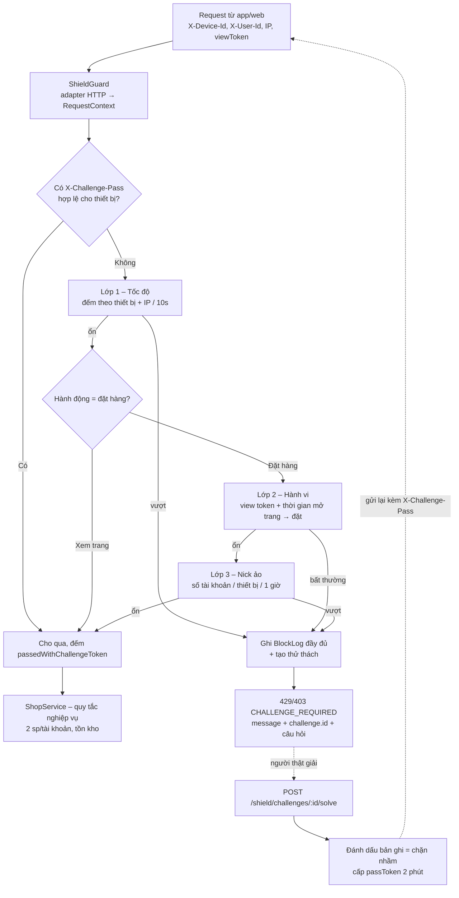

# Bài tập 9 – Lá chắn chống lạm dụng cho ngày hội mua sắm

## 1. Bản đặc tả ngắn – thu hẹp yêu cầu mở

Yêu cầu gốc: *"40% đơn flash sale rơi vào tay bot, khách thật không mua được, hệ thống sập 20 phút. Năm nay không muốn lặp lại."*

Câu này được tách thành 2 vấn đề đo được:
- **Bot chiếm hàng**: đơn bị đặt bởi chương trình tự động hoặc bởi một người dùng nhiều tài khoản.
- **Hệ thống sập**: lưu lượng rác (làm mới trang, spam nút đặt) đè lên lưu lượng thật.

Từ đó chọn 3 kịch bản lạm dụng cụ thể:

| # | Kịch bản lạm dụng | Dấu hiệu đo được | Vì sao chọn |
|---|---|---|---|
| K1 | **Bắn dồn dập**: bot làm mới trang / bấm đặt hàng liên tục từ 1 thiết bị hoặc 1 IP | Số request mỗi thiết bị/IP trong 10 giây | Nguyên nhân trực tiếp làm **sập hệ thống**; rẻ để phát hiện nên đặt ở lớp đầu |
| K2 | **Gọi thẳng API / đặt siêu tốc**: bot bỏ qua trang sản phẩm, gọi API đặt hàng ngay khi mở bán, hoặc đặt vài chục ms sau khi mở trang | Không có mã xem trang (view token) hợp lệ, hoặc thời gian mở trang → bấm đặt dưới ngưỡng con người | Đây là cách bot **thắng khách thật** về tốc độ. Bot đổi IP/thiết bị liên tục vẫn không giả được hành vi "mở trang rồi mới đặt" |
| K3 | **Nick ảo**: một thiết bị xoay vòng nhiều tài khoản để vượt giới hạn 2 sản phẩm / tài khoản | Số tài khoản khác nhau đặt hàng trên cùng thiết bị trong 1 giờ | Bot thao tác chậm như người vẫn bị lộ ở đây. Cách này giải thích vì sao **giới hạn theo tài khoản là chưa đủ** |

**Ngoài phạm vi**: thanh toán gian lận, hoàn hàng, chống DDoS tầng mạng (L3/L4, do CDN/WAF đảm nhận), CAPTCHA thật (được mô phỏng bằng phép cộng).

**Nguyên tắc với khách thật**: các lớp phát hiện đều dựa trên suy đoán nên **không bao giờ chặn cứng**, mà trả về **thử thách**. Người thật luôn có đường đi tiếp (giải xong thì đặt được), còn bot tự động dừng lại. Mỗi lần giải đúng được tính là **một lần chặn nhầm đã đo được**.

## 2. Kiến trúc

### 2.1. Sơ đồ các lớp và luồng một request



Một lớp gặp lỗi (ví dụ kho đếm mất kết nối) thì **bỏ qua lớp đó** (fail-open), ghi `policy_error` và đếm `policyErrors`. Lỗi hạ tầng không được biến thành chặn nhầm khách thật; hai lớp còn lại vẫn hoạt động.

### 2.2. Bảng các lớp phòng thủ

| Lớp | Hành vi chặn | Áp dụng | Ngưỡng mặc định (đổi được lúc chạy) | Phản hồi trả về |
|---|---|---|---|---|
| 1. Tốc độ (`VelocityPolicy`) | K1: bắn dồn dập; bot đổi mã thiết bị vẫn bị đếm theo IP | Xem trang + đặt hàng | `velocity.maxPerDevice = 20`, `velocity.maxPerIp = 60` trong `windowMs = 10.000` | `429`, `rule: device-rate / ip-rate`, thử thách |
| 2. Hành vi (`BehaviorPolicy`) | K2: gọi thẳng API, dùng view token của thiết bị/sản phẩm khác, đặt nhanh hơn người | Đặt hàng | `behavior.minViewToOrderMs = 1.500`, `viewTokenTtlMs = 10 phút` | `403`, `rule: missing-view / too-fast`, thử thách |
| 3. Nick ảo (`AccountFarmPolicy`) | K3: một thiết bị xoay nhiều tài khoản | Đặt hàng | `accountFarm.maxAccountsPerDevice = 3` trong `windowMs = 1 giờ` | `403`, `rule: accounts-per-device`, thử thách |
| Nghiệp vụ (`ShopService`) | Một tài khoản mua quá 2 sản phẩm, hết hàng | Đặt hàng | `MAX_UNITS_PER_ACCOUNT = 2` | `409` (quy tắc bán hàng, không phải phát hiện lạm dụng) |

3 lớp độc lập: mỗi lớp dùng một tín hiệu khác nhau (tần suất / hành vi / danh tính), có bộ đếm riêng và bật/tắt riêng (`enabled`).

### 2.3. Tổ chức mã nguồn theo Clean Code

```
src/shield/
  policies/        CHÍNH SÁCH: chỉ chứa quy tắc "khi nào là lạm dụng", hàm thuần, không biết HTTP/log/lưu trữ cụ thể
    policy.ts               giao diện ShieldPolicy
    velocity.policy.ts      lớp 1
    behavior.policy.ts      lớp 2
    account-farm.policy.ts  lớp 3
  engine/          CƠ CHẾ THỰC THI: chạy các lớp theo thứ tự, thử thách, nhật ký, đo lường
    shield.engine.ts        điều phối các lớp, fail-open khi một lớp lỗi
    challenge.service.ts    thử thách + passToken, đánh dấu chặn nhầm khi giải đúng
    block-log.service.ts    nhật ký chặn (JSON ra stdout + tra cứu)
    metrics.service.ts      tỉ lệ chặn / chặn nhầm theo từng lớp
    view-token.service.ts   cấp mã xem trang cho lớp 2
  storage/         TẦNG LƯU TRỮ BỘ ĐẾM: ShieldStore (trừu tượng) + MemoryShieldStore (thay bằng Redis khi nhiều instance)
  config/          ngưỡng mặc định + PolicyConfigStore (đổi lúc chạy, kiểm tra hợp lệ)
  shield.guard.ts  adapter NestJS: Request → RequestContext → engine → 403/429
src/shop/          nghiệp vụ flash sale
src/admin/         API vận hành: ngưỡng, nhật ký, báo cáo
```

Thêm một lớp mới chỉ cần viết một `ShieldPolicy` rồi thêm vào `SHIELD_POLICIES`, không phải sửa engine.

### 2.4. Đáp ứng các ràng buộc kỹ thuật

| Ràng buộc | Cách đáp ứng |
|---|---|
| ≥ 3 lớp độc lập | 3 `ShieldPolicy` với 3 tín hiệu khác nhau, bật/tắt riêng |
| Không chặn oan, có đo và báo cáo | Không chặn cứng mà trả thử thách. Giải đúng thì `falsePositive = 'challenge-solved'`. CSKH đánh dấu thủ công qua `POST /admin/shield/logs/:id/false-positive`. Báo cáo `GET /admin/shield/report` cho tỉ lệ chặn nhầm tổng và theo từng lớp |
| Log đủ để truy vết, chỉnh ngưỡng | Mỗi lần chặn ghi: `id, at, requestId, layer, rule, observed, threshold, action, challengeId, path, ip, deviceId, userId, productId, falsePositive`. Tra cứu: `GET /admin/shield/logs?layer=&deviceId=&userId=` |
| Đổi ngưỡng lúc chạy | `PATCH /admin/shield/policies`: kiểm tra toàn bộ patch, sai một trường thì không áp dụng gì. Mỗi request đọc cấu hình hiện tại nên có hiệu lực ngay, có log `policy_updated` |
| Không crash | Lớp lỗi thì fail-open + log; `AllExceptionsFilter` biến mọi lỗi thành JSON (lỗi lạ thành 500, không lộ stack); `unhandledRejection/uncaughtException` chỉ ghi log; dữ liệu xấu (JSON hỏng, số lượng sai, thiếu đăng nhập) trả 4xx rõ ràng |

## 3. Sản phẩm và kịch bản demo

- `npm start`: chạy server ở cổng 3000
- `npm test`: 17 ca kiểm thử (từng lớp, đo chặn nhầm, đổi ngưỡng lúc chạy, ngoại lệ)
- `npm run demo`: chạy 3 hành vi lạm dụng + luồng khách thật trên server thật

Kết quả `npm run demo`:

```
=== Doi nguong luc dang chay: ha minViewToOrderMs xuong 800ms de demo chay nhanh (khong khoi dong lai)
PATCH /admin/shield/policies -> 200

[Lam dung 1] Bot lam moi trang 100 lan lien tiep tu 1 thiet bi
  -> 200 x20, 429 x80  (lop Toc do chan tu request thu 21)

[Lam dung 2] Bot dat hang thang qua API (khong mo trang) hoac 50ms sau khi mo trang, moi lan 1 thiet bi moi
  -> 403 x30  (lop Hanh vi: missing-view x15, too-fast x15)

[Lam dung 3] 1 thiet bi dung 10 tai khoan khac nhau, moi tai khoan mua 1 (ne gioi han 2 sp/tai khoan)
  -> 201 x3, 403 x7  (lop Nick ao cho 3 tai khoan dau, chan tu tai khoan thu 4)

[Khach that] Chi Lan mo trang, doc 1,5 giay, dat 1 san pham
  -> 201 {"id":"DH-4","userId":"chi-lan","productId":"FS-IPHONE","quantity":1}

[Khach that bi nghi nham] Nguoi thu 4 trong gia dinh dat tren may tinh bang chung
  -> lan 1: 403 (account-farm); giai "7 + 6 = ?" = 13; dat lai: 201 -> tinh la 1 lan chan nham

=== Bao cao /admin/shield/report
Tong request: 177, bi chan: 118 (66.7%)
Chan nham da xac nhan: 1 -> ti le chan nham 0.85%
  velocity      chan  80, chan nham 0 (0.00%)
  behavior      chan  30, chan nham 0 (0.00%)
  account-farm  chan   8, chan nham 1 (12.50%)
```

Đọc báo cáo: lớp Nick ảo có tỉ lệ chặn nhầm cao nhất (12,5%, do gia đình dùng chung máy). Đội vận hành có thể nâng `accountFarm.maxAccountsPerDevice` lúc đang chạy mà không cần khởi động lại.

API chính:
- `GET /flash-sale/products/:id`: xem trang, nhận `viewToken`
- `POST /flash-sale/products/:id/orders`: body `{ viewToken, quantity }`, header `X-Device-Id`, `X-User-Id`, (tuỳ chọn) `X-Challenge-Pass`
- `POST /shield/challenges/:id/solve`: body `{ answer }`, header `X-Device-Id`
- `GET|PATCH /admin/shield/policies`, `GET /admin/shield/logs`, `POST /admin/shield/logs/:id/false-positive`, `GET /admin/shield/report` (header `X-Admin-Token: admin-secret`)
