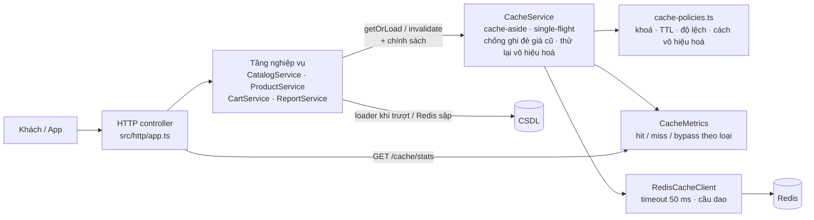

# Bài tập 9 – Tầng tăng tốc cho toàn bộ ShopFast

Mã nguồn: `src/` · Kiểm thử: `npm test` · Đo hiệu năng: `npm run bench` → `logs/benchmark.log` · Chạy thử: `npm start` (có `REDIS_URL` thì dùng Redis thật).

## 1. Bản đặc tả ngắn – thu hẹp yêu cầu mở

Yêu cầu gốc: *“Chi phí cơ sở dữ liệu tháng này tăng 60%, mà trang vẫn chậm vào giờ cao điểm. Tôi muốn giảm cả hai, nhưng tuyệt đối không được để khách nhìn thấy giá sai.”*

| Câu trong yêu cầu | Diễn giải thành mục tiêu đo được |
|---|---|
| “Chi phí CSDL tăng 60%” | Giảm **số truy vấn** và **tổng thời gian CSDL phải làm việc** (đại diện cho chi phí) cho cùng một lượng truy cập giờ cao điểm. |
| “Trang vẫn chậm vào giờ cao điểm” | Giảm **p95 độ trễ** của request khi có nhiều request đồng thời. |
| “Tuyệt đối không để khách thấy giá sai” | Giá vừa đổi phải hiển thị ngay ở trang sản phẩm **và** giỏ hàng; không có tình huống nào (tranh chấp nạp/ghi, Redis sập rồi sống lại) làm giá cũ bị đệm lại. Đo bằng số lần “đọc giá sai” = 0. |

**Phần hệ thống được chọn** (những màn hình được gọi nhiều nhất giờ cao điểm, mỗi màn đại diện một loại dữ liệu khác nhau):

| Phần hệ thống | Loại dữ liệu | Vì sao ưu tiên |
|---|---|---|
| Thanh danh mục (mọi trang đều gọi) | Hầu như không đổi | Gọi nhiều nhất, đệm gần như 100% → giảm truy vấn rẻ nhất |
| Trang chi tiết sản phẩm | Đổi thường xuyên (giá) | Lượng xem lớn nhất, lại chứa **giá** – nơi rủi ro “giá sai” cao nhất |
| Giỏ hàng | Riêng từng người dùng | Bị gọi mỗi lần mở trang; rủi ro lộ dữ liệu người khác nếu khoá sai |
| Top bán chạy | Tổng hợp tốn tài nguyên | Mỗi lần tính mất ~400 ms (quét bảng đơn hàng) – thủ phạm chính của chi phí CSDL |

**Ngoài phạm vi**: thanh toán/đặt hàng (luôn đọc giá thẳng CSDL, không qua tầng đệm), tìm kiếm toàn văn, đệm ở CDN/trình duyệt.

## 2. Kiến trúc



| Tầng | File | Trách nhiệm (không lẫn sang tầng khác) |
|---|---|---|
| Chính sách lưu đệm | `src/cache/cache-policies.ts` | Nơi **duy nhất** định nghĩa khoá, TTL, độ lệch, có chống ghi đè hay không cho từng loại dữ liệu |
| Truy cập Redis | `src/cache/redis-cache.client.ts` | Lệnh Redis + timeout + cầu dao; **không bao giờ ném lỗi** lên trên, trả `{ ok: false }` |
| Điều phối đệm | `src/cache/cache.service.ts` | Cache-aside chung: đọc → trượt → nạp → ghi; single-flight; vô hiệu hoá + hàng đợi thử lại |
| Đo lường | `src/cache/cache-metrics.ts` | Đếm trúng/trượt/bỏ qua theo loại dữ liệu, `GET /cache/stats` |
| Nghiệp vụ | `src/domain/shop.services.ts` | Chỉ biết “dùng chính sách nào, nạp từ đâu, khi nào vô hiệu hoá” – không biết Redis |
| Lắp ráp | `src/container.ts`, `src/http/app.ts` | Nối các tầng, HTTP |

**Luồng đọc** (`CacheService.getOrLoad`)
1. Khoá đang chờ vô hiệu hoá (đổi dữ liệu lúc Redis sập) → đọc thẳng CSDL.
2. `GET` Redis.
   - Trúng → trả về (`hit`).
   - Redis lỗi/timeout/cầu dao mở → `bypass`.
   - Không có → `miss`.
3. Gộp các lần nạp trùng khoá trong một instance (single-flight).
4. Nếu chính sách có `guardWrites`: đọc `epoch` của khoá **trước** khi đọc CSDL.
5. Nạp từ CSDL.
6. Ghi Redis với `TTL + độ lệch ngẫu nhiên`; với `guardWrites` chỉ ghi khi `epoch` chưa đổi (script Lua nguyên tử).

**Luồng ghi** (vd. đổi giá): ghi CSDL → `INCR epoch` + `DEL khoá` → bỏ lần nạp đang chạy khỏi single-flight. Nếu Redis lỗi → đưa khoá vào hàng đợi vô hiệu hoá: khoá đó bị đọc thẳng CSDL và được xoá lại ngay khi Redis hoạt động.

## 3. Bảng chính sách theo loại dữ liệu

| Loại dữ liệu | Ví dụ | Mẫu khoá | Thời gian sống | Điều kiện vô hiệu hoá | Lý do lựa chọn |
|---|---|---|---|---|---|
| **Hầu như không đổi** (`static`) | Danh mục sản phẩm | `sf:v1:static:categories` | 24 giờ + lệch 0–1 giờ | Admin sửa danh mục (`PUT /categories`) → `DEL` | Đổi vài lần/tháng, đọc ở mọi trang → TTL dài nhất; vẫn xoá ngay khi sửa để không chờ 24 giờ. Lệch để các instance không cùng nạp lại một lúc. |
| **Đổi thường xuyên** (`product`) | Chi tiết sản phẩm (có giá) | `sf:v1:product:<id>` (+ `:epoch`) | 5 phút + lệch 0–60 giây | Đổi giá (`PATCH /products/:id/price`) → `INCR epoch` + `DEL`; lỗi thì đưa vào hàng đợi thử lại | Giá phải đúng tuyệt đối → **xoá ngay khi ghi**, chặn tình huống lần nạp chậm ghi đè giá cũ (epoch), không cho request mới ghép vào lần nạp cũ. TTL 5 phút chỉ là lưới an toàn cho thay đổi đi đường khác. |
| **Riêng từng người dùng** (`user`) | Giỏ hàng | `sf:v1:user:<userId>:cart` (+ `:epoch`) | 30 phút | Chính người đó thêm/sửa giỏ → `INCR epoch` + `DEL` | `userId` lấy từ danh tính đã xác thực (header từ gateway), **không** từ tham số → không thể đọc giỏ người khác. Chỉ đệm *dòng hàng* (`productId`, `qty`); **giá được ghép từ bản ghi sản phẩm** khi hiển thị → đổi giá là giỏ hàng thấy ngay, không cần xoá hàng nghìn giỏ. |
| **Tổng hợp tốn tài nguyên** (`aggregate`) | Top bán chạy theo danh mục | `sf:v1:agg:top-sellers:<category>` | 10 phút + lệch 0–2 phút | Không vô hiệu hoá khi có đơn mới – chỉ hết hạn theo TTL | Mỗi lần tính ~400 ms; thứ hạng lệch vài phút không ảnh hưởng quyết định mua và **không chứa giá**. Vô hiệu theo từng đơn sẽ làm tỉ lệ trúng ≈ 0 giờ cao điểm. `category` được kiểm tra theo danh sách cho phép → số khoá hữu hạn. |

Tiền tố `sf:v1` cho phép đổi cấu trúc giá trị khi deploy (`v2`) mà không đọc nhầm dữ liệu cũ.

## 4. Redis không sẵn sàng – chỉ chậm đi, không sập

| Tình huống | Xử lý (`RedisCacheClient`, `CacheService`) |
|---|---|
| Redis từ chối kết nối | Lệnh lỗi ngay (`enableOfflineQueue: false`) → `bypass`, đọc CSDL |
| Redis treo (không trả lời) | Mỗi lệnh bị cắt sau **50 ms** |
| Lỗi liên tiếp | Sau **5 lần** lỗi liên tiếp, cầu dao **mở 5 giây**: không gọi Redis nữa, request không phải chờ timeout |
| Hết 5 giây | Cầu dao chuyển `half-open`, request kế tiếp thử Redis; thành công → `closed`, đệm hoạt động lại |
| Đổi giá khi Redis sập | Không xoá được khoá → lưu vào hàng đợi vô hiệu hoá; khoá đó **luôn đọc CSDL** cho tới khi xoá được → khi Redis sống lại không trả giá cũ còn sót |
| Lỗi bất kỳ trong tầng đệm | Không bao giờ lan lên tầng nghiệp vụ; trong kịch bản Redis treo: **0 lỗi / 6.000 request** |

## 5. Báo cáo hiệu năng trước và sau

Kịch bản (`src/benchmark.ts`, cùng hạt giống ngẫu nhiên cho cả 3 lần chạy): 6.000 request, 50 request đồng thời.

| Tỉ lệ | Thao tác |
|---|---|
| 25% | Xem danh mục |
| 40% | Xem sản phẩm (80% vào 20 sản phẩm hot) |
| 15% | Xem giỏ (2.000 người dùng) |
| 3% | Thêm vào giỏ |
| 15% | Xem top bán chạy |
| 2% | **Đổi giá sản phẩm hot** (cố tình tạo tranh chấp với lượt xem) |

Độ trễ CSDL giả lập: danh mục 20 ms, sản phẩm 30 ms, giỏ 15 ms, tổng hợp đơn hàng 400 ms.

| Chỉ số | Trước (không có tầng đệm) | Sau (có tầng tăng tốc) | Sau, **Redis treo hoàn toàn** |
|---|---|---|---|
| Tổng truy vấn CSDL | 6.587 | **1.227 (−81,4%)** | 4.317 |
| – danh mục / sản phẩm / giỏ / đơn hàng | 1.529 / 2.911 / 1.236 / 911 | 1 / 371 / 849 / 6 | 231 / 2.749 / 1.236 / 101 |
| Thời gian CSDL bận (chi phí) | 500.850 ms | **26.285 ms (−94,8%)** | 146.030 ms |
| Độ trễ p50 / p95 / p99 | 31,2 / 405,8 / 408,2 ms | **0,0 / 52,2 / 107,3 ms** | 31,1 / 326,1 / 405,2 ms |
| Thông lượng | 548 req/s | **4.356 req/s** | 794 req/s |
| Request lỗi | 0 | 0 | **0** |
| Lần đọc giá sai | 0 | **0** | 0 |

- Với cùng lượng truy cập, CSDL nhận ít hơn 81% truy vấn và bận ít hơn 95% thời gian. Phần giảm lớn nhất đến từ truy vấn tổng hợp: 911 → 6.
- Dù 2% request liên tục đổi giá sản phẩm hot, không lần đọc nào trả giá sai. “Đọc giá sai” nghĩa là giá trả về không đúng với giá trong CSDL ở bất kỳ thời điểm nào trong suốt request.
- Khi Redis treo, hệ thống không lỗi request nào và không chậm hơn lúc chưa có tầng đệm. Request vẫn nhanh hơn một chút nhờ single-flight gộp các lần nạp trùng trong instance.

### Tỉ lệ trúng bộ nhớ đệm theo từng loại dữ liệu (kịch bản “Sau”)

| Loại dữ liệu | Request | Trúng | Trượt | Tỉ lệ trúng | Nhận xét |
|---|---|---|---|---|---|
| `static` – danh mục | 1.529 | 1.516 | 13 | **99,2%** | 13 lần trượt là đợt đầu khi 50 request đồng thời cùng gặp khoá trống |
| `aggregate` – top bán chạy | 911 | 854 | 57 | **93,7%** | 6 khoá (6 danh mục); trượt đầu tiên được gộp nên chỉ 6 truy vấn CSDL |
| `product` – sản phẩm | 2.804 | 2.170 | 634 | **77,4%** | Gồm cả lượt đọc từ giỏ hàng. Trượt chủ yếu do sản phẩm hot bị đổi giá liên tục – cái giá chấp nhận để giá luôn đúng |
| `user` – giỏ hàng | 1.057 | 383 | 674 | **36,2%** | 2.000 người dùng, mỗi người chỉ vài lượt trong kịch bản ngắn. Ở thực tế, một khách mở giỏ nhiều lần trong một phiên nên tỉ lệ sẽ cao hơn |

Tỉ lệ trúng được báo cáo trực tiếp lúc chạy qua `GET /cache/stats`:

```json
{ "redis": "closed", "pendingInvalidations": 0,
  "byKind": { "product": { "hits": 2170, "misses": 634, "bypass": 0, "requests": 2804, "hitRatio": 0.7739 }, "...": {} } }
```

## 6. Kiểm thử (`npm test`)

| Test | Kết quả |
|---|---|
| Cả 4 loại: lần 2 trúng, không xuống CSDL; TTL đúng chính sách (24h+, 5–6 phút, 30 phút, 10–12 phút) | ✅ |
| Danh mục: admin sửa → đọc lại thấy ngay | ✅ |
| Top bán chạy: đơn mới không xoá bản đệm (độ trễ chấp nhận được) | ✅ |
| Đổi giá → trang sản phẩm và tổng tiền giỏ hàng thấy giá mới ngay | ✅ |
| Lần nạp chậm đọc giá cũ, giá đổi xong mới ghi → **giá cũ không được ghi vào Redis** (epoch) | ✅ |
| Request đến sau khi đổi giá không ghép vào lần nạp cũ đang chạy | ✅ |
| Giỏ hàng người này không lọt sang người khác | ✅ |
| Redis từ chối kết nối → mọi request vẫn thành công, cầu dao mở, metrics ghi `bypass` | ✅ |
| Redis treo → mỗi lệnh bị cắt 50 ms, sau 5 lần lỗi không còn chờ Redis | ✅ |
| Redis hồi phục → cầu dao đóng lại, đệm hoạt động tiếp | ✅ |
| Đổi giá lúc Redis sập → khi Redis sống lại không trả giá cũ còn sót trong Redis | ✅ |
| HTTP: thiếu `x-user-id` → 400, danh mục sai → 400, sản phẩm không có → 404, `/cache/stats` | ✅ |

```
# tests 12
# pass 12
# fail 0
```
